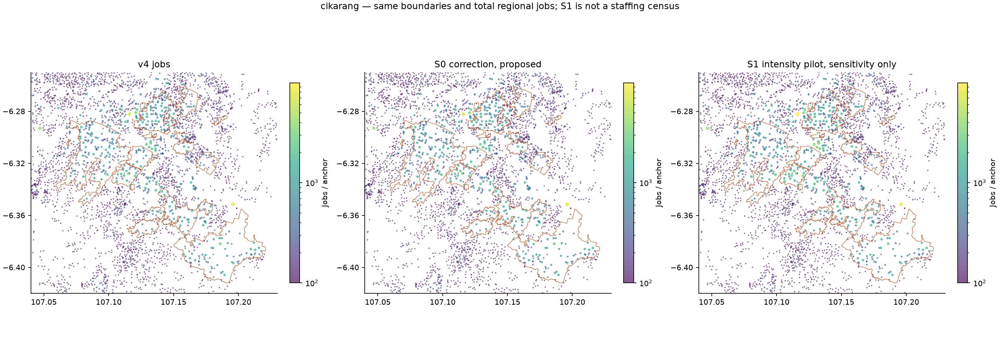
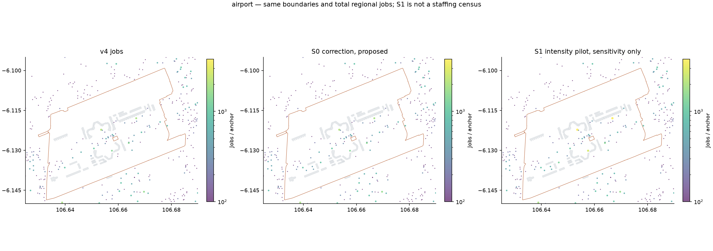

# Audit bandara dan kawasan industri v4.1

**Stage A — audit dan proposal, 8 November 2026. Belum diinstal dan belum diuji di game.** Produksi tetap Organic v4 / mod 0.2.1, commit `dfec7f2`. Tidak ada perubahan engine, peta, atau aset game.

Angka “penduduk” di dokumen ini adalah seluruh inhabitants; “asal pekerja” adalah model working trip-makers; “jobs” adalah estimasi tujuan kerja. S0 adalah koreksi klasifikasi konservatif. S1 adalah sensitivitas intensitas, **bukan** target pegawai hasil observasi. OD30 dan OD40 adalah skenario terpisah dari koreksi geografis S0.

Batas kecamatan/desa memakai union batas BIG Juni 2026. Kompleks industri memakai poligon OSM bernama; koridor bisnis memakai potongan poligon aktivitas dalam jendela audit. BSD/Gading Serpong/Alam Sutera/Sentul memiliki subset hunian terpetakan atau envelope administratif yang dilabeli: tidak diklaim sebagai batas legal township lengkap. Area tumpang tindih **tidak boleh dijumlahkan**. [Semua batas dan label cakupan](organic-v41/audit_boundaries.geojson.gz).

## Kawasan industri: apa yang benar-benar diukur

Poligon industri bernama bukan ukuran pasti lahan **sudah ditempati**. Density dibawah adalah semua jobs model dalam batas dibagi class50 WorldCover2021 di batas itu; ia hanya proxy built-up historis. Kolom luas penuh/mapped industrial, nonnatural-land proxy, roof area dan density pada denominator lain disediakan dalamCSV. Tidak ada klaim telah memetakan occupied industrial hectares2025 secara lengkap. Landbank GIIC/Jababeka dan roof coverage yang kurang bisa membias denominator. Pending data operator occupied-lots per fasilitas, jangan gunakan jobs/ha proxy sebagai target observasi.

| Kawasan / batas terpetakan | Luas ha | Built-up2021 ha | Jobs v4 | S0 | S1 pilot | Jobs/built-up ha v4→S0 | Factory / warehouse eligible |
|---|---|---|---|---|---|---|---|
| Jababeka | 1433.03 | 944.28 | 75,900 | 75,900 | 78,500 | 80.38 → 80.38 | 2397 / 1 |
| MM2100 | 1890.74 | 1171.75 | 80,200 | 80,200 | 81,900 | 68.44 → 68.44 | 1249 / 3 |
| EJIP | 302.43 | 257.1 | 21,500 | 21,500 | 30,000 | 83.62 → 83.62 | 106 / 0 |
| Lippo Cikarang industrial parcels | 1347.49 | 712.21 | 53,600 | 53,600 | 53,900 | 75.26 → 75.26 | 1304 / 1 |
| GIIC / Kota Deltamas industrial | 2115.0 | 583.15 | 48,100 | 48,100 | 48,300 | 82.48 → 82.48 | 900 / 0 |
| Marunda | 570.76 | 252.78 | 15,600 | 15,600 | 15,500 | 61.71 → 61.71 | 277 / 0 |
| Pulogadung | 422.61 | 369.02 | 39,800 | 39,800 | 40,500 | 107.85 → 107.85 | 698 / 1 |
| Cikupa Mas | 146.25 | 115.67 | 4,100 | 4,100 | 4,100 | 35.44 → 35.44 | 42 / 0 |
| Balaraja named industrial parcels | 97.66 | 60.15 | 4,500 | 4,500 | 5,300 | 74.81 → 74.81 | 207 / 0 |
| Cibitung industrial clusters | 11.25 | 4.48 | 100 | 100 | 100 | 22.33 → 22.33 | 11 / 0 |
| Cakung industrial clusters | 1266.09 | 1067.58 | 93,500 | 93,500 | 96,000 | 87.58 → 87.58 | 1902 / 1 |
| Jatiuwung industrial clusters | 1206.1 | 975.88 | 20,000 | 19,900 | 21,000 | 20.49 → 20.39 | 323 / 0 |

**Perbandingan operator dan cakupan:** EJIP menyebut320ha dan91tenant; poligon OSM302.43ha adalah pendekatan footprint, bukan jaminan coverage pegawai. MM2100 operator menyebut±2000ha termasuk partner; OSM1890.74ha mendekati luas itu tetapi bukan occupied-land proof. Profil Jababeka menyebut700000workers pada township5600ha; audit ini memakai1433.03ha poligon fase industri bernama. Publikasi pemasaran lain memakai captive-market1juta workers. Angka-angka itu **tidak dijumlahkan** atau dipakai sebagai target pada subset industrial yang berbeda. GIIC melaporkan tenant termasuk data center; tenant tidak dikonversi menjadi pegawai seragam. Sumber rinci dan tahun/akses ada di [master](ORGANIC_V41_MASTER_AUDIT.md#provenance-dan-tingkat-kepastian).

Cibitung sebagai alamat pemasaran tidak selalu sama dengan kecamatan BIG Cibitung. MM2100 sebagian besar berada dalam footprint yang ditabelkan sendiri; subset industrial Cibitung yang kecil tidak menjadi alasan untuk memindahkan MM2100 ke kecamatan bernama sama pada alamat surat. Jatiuwung dan Cakung memakai industrial parcels dalam batas kecamatan, Marunda menggabungkan subset bernama yang bisa melintasi region. Hindari menjumlahkan footprint estate dengan envelope koridor.

**Rekomendasi per fasilitas:** verifikasi tenant aktif dan jenis factory/warehouse/data center; gunakan building parts/floor space dan staffing fisik bila terbit. Operator/estate-management, individual tenants dan retail pendukung harus masuk ledger unik. Tidak ada total pegawai tepercaya yang sebanding ditemukan untuk setiap estate; tabel S1 tidak boleh dibaca sebagai kekurangan pegawai yang telah terkonfirmasi.

## Soekarno–Hatta

| Metrik | Current | S0 | S1 sensitivity |
|---|---|---|---|
| Inhabitants dalam aerodrome | 7,996 | 5,104 | 5,104 |
| Asal pekerja model | 2,800 | 1,700 | 1,700 |
| Jobs model | 13,500 | 15,000 | 21,300 |
| Allocation anchors | 51 | 57 | 57 |
| Jobs / ha aerodrome | 8.9 | 9.89 | 14.04 |

Pembagian berikut **saling eksklusif pada anchor**, sehingga tidak menambahkan staffing kantor ke tenant lagi. Pekerjaan agregat cluster tidak selalu mempunyai detail setiap subtenant. Kategori yang tak dapat dipisah tetap terlihat sebagai unclassified, bukan diberi jumlah staff rekaan.

| Fungsi anchor | Jobs current | Jobs S0 | S1 pilot | Inhabitants current→S0 |
|---|---|---|---|---|
| ground_handling | 300 | 200 | 200 | 176 → 0 |
| maintenance_hangars | 0 | 2,200 | 3,300 | 0 → 0 |
| operator_airline_offices | 800 | 500 | 500 | 1,861 → 0 |
| passenger_terminal_buildings | 5,900 | 5,900 | 11,200 | 0 → 0 |
| retail_hospitality | 0 | 0 | 0 | 0 → 0 |
| support_operations | 100 | 100 | 100 | 672 → 0 |
| unclassified_or_neighborhood | 6,300 | 6,000 | 5,900 | 5,287 → 5,104 |
| warehouses_unclassified | 100 | 100 | 100 | 0 → 0 |

Kargo, keamanan, airline operations, operator, retail dan ground-handling belum semuanya dapat dipisahkan dari generic building/warehouse. **Tidak teridentifikasi sebagai kategori terpisah bukan berarti pekerjanya nol.** Tidak dibuat target pegawai subfungsi yang tidak terverifikasi. Pelacakan fasilitas: [airport_facility_capacity.csv](organic-v41/airport_facility_capacity.csv).

Sumber yang berhasil diverifikasi adalah pernyataan Presiden Direktur AP II pada8Desember2022, disiarkan ANTARA, tentang komunitas pekerja harian50000–60000. Ini bukan target40000–50000payroll2025 dengan geografi yang identik. Angka harian tidak dapat dijadikan jumlah serentak dalam satu shift; pekerja bergilir/kontraktor dan fasilitas offsite belum direkonsiliasi. Tidak ada Terminal4/Cargo Village masa depan yang ditambahkan berdasarkan rencana dalam artikel itu.

S0: pulihkan6 interior hanggar pada prior transport lama150m²/relative-worker; nol inhabitants pada tank/parking/named operational anchors yang terbukti. S1: terminal80 dan hanggar100 sebagai sensitivitas, bukan global transport boost. **Airport employee commutes tetap regular job IDs**, bukan `AIR_` passenger demand. Waktu shift/akses staff memerlukan data terpisah.

Nol hit available runway/taxiway/apron masks, tetapi akses jalan privat/pintu staff belum dibuktikan untuk seluruh fasilitas. StageB wajib menggunakan sisi akses pekerja pada bangunan dan memeriksa grouping tidak melintasi fasilitas.5,104 inhabitants yang tersisa dalam aerodrome adalah flag klasifikasi residual; jangan otomatis menganggapnya residential nyata atau menghapus semua tanpa bukti.

[Semua metrik area](organic-v41/AREA_DETAILS.md), [boundary GeoJSON](organic-v41/audit_boundaries.geojson.gz), [sensitivity ceiling](organic-v41/capacity_sensitivity.csv).
