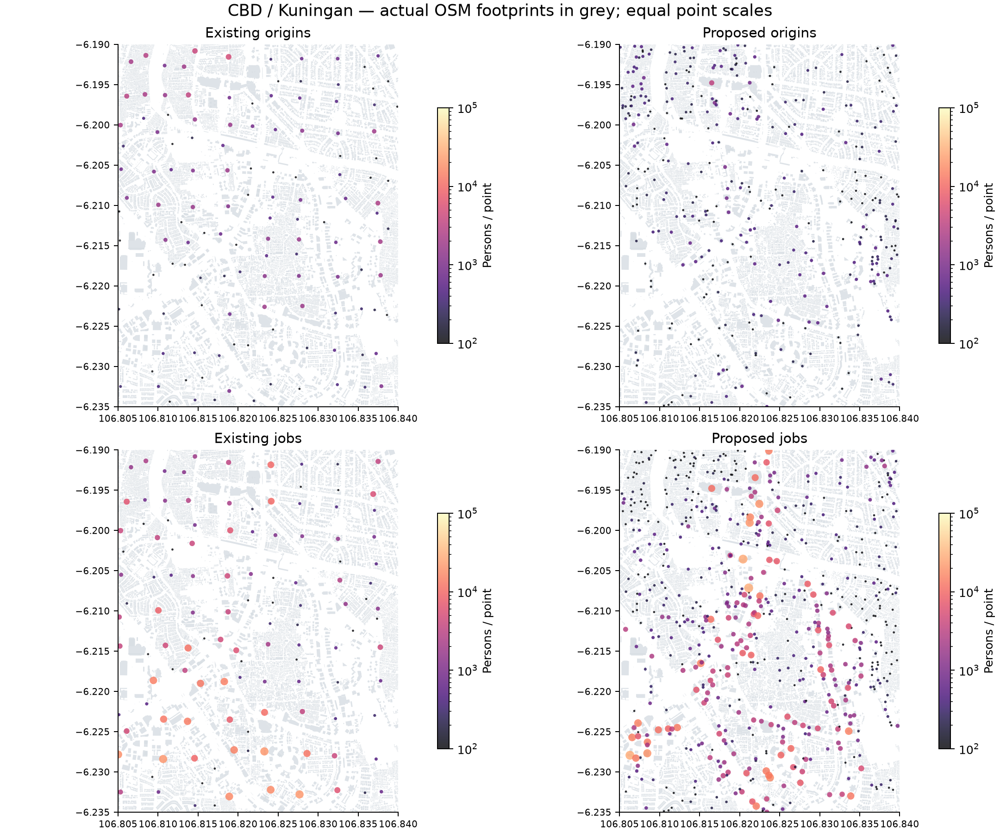
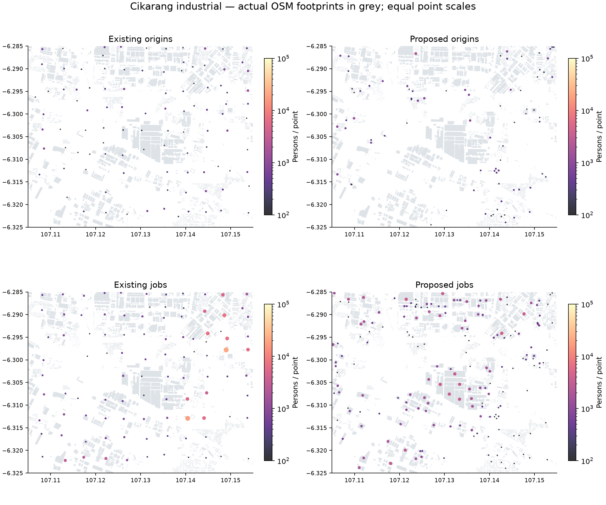
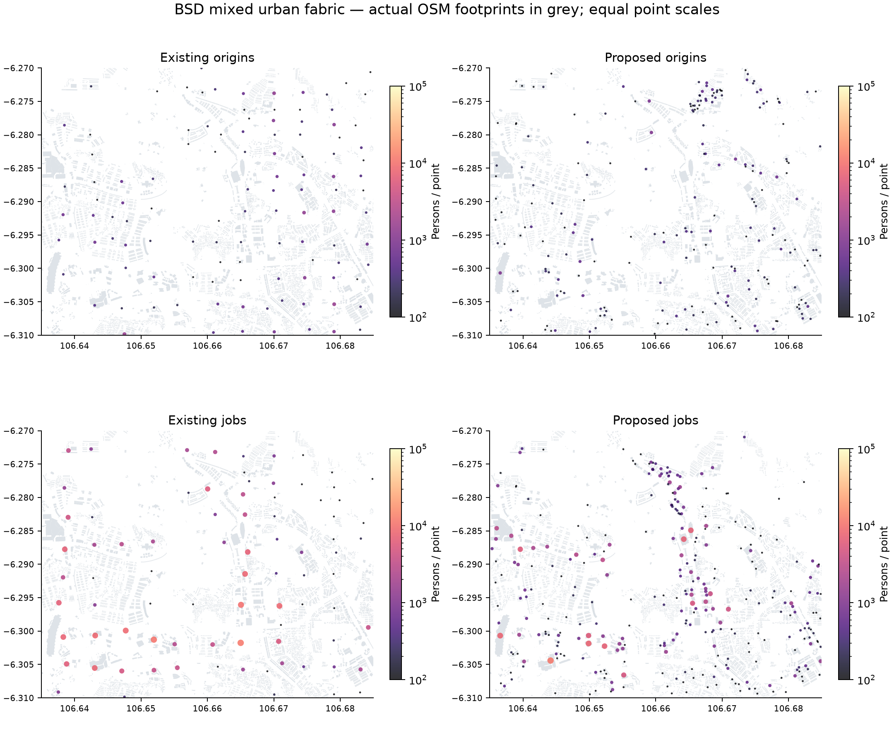

# Employment density audit — Stage A

Semua hitungan jobs di bawah adalah **alokasi model**, bukan jumlah pekerja teramati. Jendela audit saling tumpang tindih dan bukan batas pusat ekonomi. Tidak ada Gaussian boost, faktor multiplier berbasis nama pusat, atau bobot seragam seluruh kecamatan.

## 15 pusat prioritas

| Prioritas / pusat | Jobs lama | Jobs preview | Perubahan | Penilaian dan tindak lanjut |
|---|---|---|---|---|
| P0 Sudirman–Thamrin–SCBD | 820,300 | 1,663,500 | 102.8% | Prioritas lantai menara meningkatkan bobot; cek podium, parts dan okupansi sebelum menerima lonjakan. |
| P0 Kuningan–Mega Kuningan–Rasuna Said | 331,000 | 705,300 | 113.1% | Office corridor terdeteksi; pisahkan menara, rumah dan retail Rasuna tanpa booster seluruh kelurahan. |
| P0 Gatot Subroto–Semanggi | 516,900 | 823,900 | 59.4% | Overlap SCBD/Kuningan; hitungan jendela tidak boleh dijumlahkan. |
| P0 TB Simatupang–Cilandak | 615,300 | 370,600 | -39.8% | Penurunan preview adalah flag kemungkinan office/floor coverage lemah; bukan bukti penurunan pekerjaan riil. |
| P0 Cikarang–Cibitung–MM2100–Jababeka | 904,800 | 1,039,900 | 14.9% | Pertahankan footprint pabrik terpisah gudang; join526 situs industri sebagai bukti lokasi, bukan staffing. |
| P1 BSD–Serpong | 277,800 | 285,000 | 2.6% | Angka jendela relatif stabil; BSD punya office/retail/institusi, jangan ratakan seluruh Serpong. |
| P1 Alam Sutera–Gading Serpong | 323,900 | 447,700 | 38.2% | Pusat suburban menguat dari geometri; validasi mall versus kantor dan area kosong. |
| P1 Sunter–Kelapa Gading | 691,200 | 500,800 | -27.5% | Penurunan harus diperiksa terhadap warehouse, pelabuhan dan fungsi low-rise yang kurang bertag. |
| P1 Cakung–Pulogadung | 449,600 | 441,900 | -1.7% | Pisahkan estate/factory/logistics dari rumah di Cakung; angka sama tidak membuktikan distribusi sama. |
| P1 Slipi–Palmerah–Grogol | 458,900 | 387,400 | -15.6% | Koridor retail/institusi beragam; fallback neighborhood membantu tetapi masih asumsi. |
| P1 Pluit–PIK–Penjaringan | 249,500 | 302,000 | 21.0% | Reklamasi, perairan dan perkembangan baru sensitif terhadap tanggal coastline dan coverage. |
| P1 Jatiuwung–Batuceper–Balaraja | 1,117,600 | 1,196,900 | 7.1% | Jendela sangat lebar dan menggabungkan pusat terpisah; footprint estate adalah unit yang tepat. |
| P2 Margonda–Depok | 333,700 | 183,600 | -45.0% | Penurunan preview tidak boleh langsung diterima: UI, kampus, retail dan mixed towers perlu parts/POI. |
| P2 Bekasi Selatan–Summarecon | 254,200 | 395,600 | 55.6% | Pusat lokal meningkat; cek kantor/retail Summarecon dan kerja lingkungan secara terpisah. |
| P2 Bogor Tengah–Baranangsiang | 215,400 | 233,400 | 8.4% | Pusat kota/institusi terwakili; jangan geser jobs dari desa Bogor yang minim mapping ke sini. |

Total jendela tidak aditif; khusus Jatiuwung–Batuceper–Balaraja gunakan tiga subarea saat inspeksi lanjutan. Perubahan batas jendela juga dapat mengubah jumlah tanpa perubahan ekonomi. Lihat [CSV](organic-stage-a/employment_centers.csv) dan [bbox eksplisit](organic-stage-a/employment_centers.json).

## Bukti fisik, fungsi dan kapasitas

Footprint dan tag OSM merupakan bukti geometri/fungsi yang dicatat pemeta, bukan pengukuran okupansi. Point-on-surface berada di gedung sumbernya. Dalam preview, kontributor hanya diagregasi dalam fungsi dan desa yang sama dengan radius maksimum500m. Kuota jobs tetap per region. Residential/mixed use juga menerima komponen neighborhood employment20%; ini prior skenario, bukan statistik terukur.

Office, government, factory, warehouse, retail, pasar, universitas, sekolah, rumah sakit, hotel, exhibition, community dan transport dibedakan. Tag `shop=mall` mendahului `building=commercial`; `building=industrial` mendahului `office=company`. Storage tanks dan hangar airside dikeluarkan; terminal bandara diperlakukan nonhunian; tempat ibadah dan bangunan transport tidak dihitung sebagai rumah generik. Mall dengan envelope lebih dari8lantai ditandai mixed-use secara inferensial; podium/tower harus diperiksa sebelum produksi.

Potensi distorsi tersisa: banyak fungsi tidak bertag; factory1lantai dan kantor3lantai adalah fallback; parts659 belum digabung; nodePOI30.375 belum di-join; situs industri resmi belum dimasukkan kembali ke preview. Floor area yang tersedia di-normalisasi ke margin region sehingga kandidat yang jarang bisa tetap menerima terlalu banyak jobs. Karena itu outlier baru bukan kapasitas bangunan yang terukur.

ITC Cempaka Mas menerima164.600 jobs di model lama. Titik itu berada dalam footprint OSM mall13lantai; tidak ditemukan sumber staffing yang membenarkan angka tersebut. Ini contoh kebutuhan pemeriksaan fungsi campuran, luas lantai dan besaran catchment, bukan alasan menghapus konsentrasi ekonomi di sana.

## Regional: pertahankan dahulu, jangan jadikan registrasi sebagai physical census

| Region | Asal pekerja tetap | Jobs tetap | Rasio jobs/asal |
|---|---|---|---|
| Bekasi | 1,350,000 | 1,255,400 | 0.93 |
| Bogor | 2,129,800 | 1,963,600 | 0.92 |
| Kota Bekasi | 1,010,100 | 840,200 | 0.83 |
| Kota Bogor | 450,000 | 437,400 | 0.97 |
| Kota Depok | 793,200 | 529,100 | 0.67 |
| Kota Jakarta Barat | 980,800 | 634,000 | 0.65 |
| Kota Jakarta Pusat | 408,600 | 1,199,200 | 2.93 |
| Kota Jakarta Selatan | 923,000 | 2,080,800 | 2.25 |
| Kota Jakarta Timur | 1,212,200 | 582,700 | 0.48 |
| Kota Jakarta Utara | 667,100 | 706,600 | 1.06 |
| Kota Tangerang | 769,100 | 852,700 | 1.11 |
| Kota Tangerang Selatan | 564,600 | 522,100 | 0.92 |
| Tangerang | 1,388,200 | 1,042,900 | 0.75 |

JUTPI2018 adalah prior historis. Jamsostek202406 mendistribusikan porsi DKI berdasarkan alamat perusahaan terdaftar, berisiko mengonsentrasikan payroll kantor pusat. JICA [Annex04 socioeconomic](https://openjicareport.jica.go.jp/pdf/12356382.pdf), Table39, merupakan sumber historis, bukan kontrol2026. Jumlah perusahaan,105 industri besar Tangerang,526 situs Bekasi dan daftar perusahaan Bekasi Kota adalah proksi keberadaan/struktur, bukan jumlah pekerja. Jangan mengubahnya menjadi staffing presisi.

Rekomendasi StageA: **tidak mengubah margin regional sekarang**. Uji redistribusi dalam region dahulu. Sebelum rebalancing, bandingkan payroll menurut alamat fisik, tenaga kerja perusahaan/kawasan, commuter workplace survey dan luas lantai aktif. Jalankan skenario pemindahan5/10/15% porsi jobs pusat ke suburban hanya bila bukti independen mendukung, dengan zero-sum regional ledger dan interval ketidakpastian. Skenario tersebut belum dijalankan dan tidak disajikan sebagai fakta.

## Cluster tambahan

Algoritme mengurutkan jobs dalam radius500m, kemudian mengambil puncak yang terpisah minimal2,5km. Ini menemukan konsentrasi **model**, bukan pusat nyata yang sudah terverifikasi. [Daftar30 cluster](organic-stage-a/discovered_clusters.json) mencatat koordinat, region, desa dan apakah berada di jendela prioritas. Kandidat di luar jendela perlu penamaan/verifikasi manual terhadap fungsi bangunan; jangan otomatis menambahkan booster dari puncak model sendiri.

## Visual untuk pemeriksaan

Simbol dan skala warna identik untuk before/after; jumlah per titik adalah agregat, bukan karyawan gedung anchor. Footprint abu-abu memberikan konteks fisik. Sumbu lon/lat; lokasi dapat dicocokkan melalui OSM ID pada allocation JSON.
