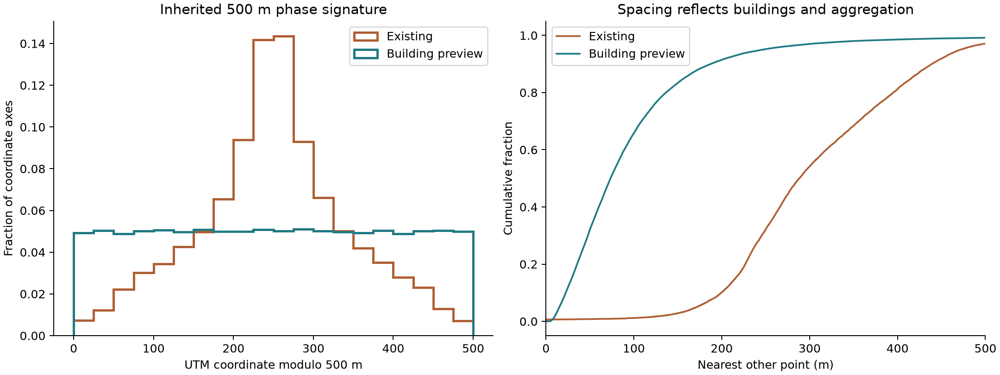
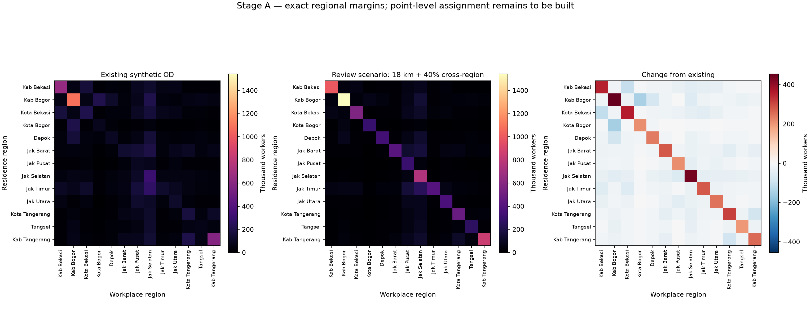

# Organic demand audit — Stage A

Tanggal audit:2026-11-07. Baseline:`824ec8e7f42484c680e7b2467cbb7dccf62df289`. **Aset produksi tidak diubah.** Ini audit dan proposal, bukan demand pengganti yang siap dipasang.

Rekomendasi: lanjutkan metode berbasis footprint dengan konservasi administratif dan transport ber-margin eksak, tetapi selesaikan coverage, fungsi/floor-area dan kalibrasi OD sebelum memasang hasil. Menghapus grid saja tidak cukup.

## Yang sudah diperiksa

`DATA_GUIDE.md`, seluruh7 sumber pemerintah yang diminta (coverage, estimates, population controls, workplace proxies, manifest, quality issues), `demand-method.json`, `BUILD_STATUS.json`, preparasi pemerintah/WorldPop/land-use, generatorv2/v3, sampling bangunan, validator, installer dan konfigurasi mod. Sumber pemerintah ditinjau dengan keterbatasan yang sudah tercatat; tidak menghidupkan kembali tabel Bogor/Tangerang/Depok yang sebelumnya ditolak.

Engine memakai **geographic demand points** dan grup `pops` yang mereferensikan ID asal/tujuan; building index adalah aset geometri terpisah. Ini didukung [panduan custom cities resmi](https://www.subwaybuilder.com/docs/guides/custom-cities) dan jalur renderer1.7.2 `buildPopLocations` yang membaca `point.location`. Anchor tidak harus tercantum dalam index30.000 bangunan. Tidak ada alasan mengubah engine.

## Temuan terukur

| Ukuran | Baseline | Preview non-produksi |
|---|---|---|
| Titik | 24,943 | 71,901 |
| Inhabitants dikontrol | 32,615,007 | 32,615,007 termasuk ledger |
| Working origins terlokasi | 12,646,700 | 12,404,600 |
| Working origins belum terlokasi | — | 242,100 |
| Jobs dialokasikan | 12,646,700 | 12,646,700 |
| Penduduk belum terlokasi | Tidak diuji | 633,996 |
| Jobs maksimum per titik | 164,600 | 49,200 |
| Jobs pada top1% titik | 29.3% | 32.8% |
| Titik di footprint sumbernya | 3.564 berada pada suatu footprint | 71,901 / 71,901 |
| Titik mengenai air paket | 275 | 0 |
| Kontrol penduduk resmi | 446 source-level | 446 eksak jika ledger dihitung |
| File produksi berubah | — | 0 |

21.379/24.943 titik lama berada di luar footprint terpetakan; ini **bukan** bukti semua titik tersebut berada di lokasi mustahil—parcel berkembang juga dapat menjadi anchor yang sah. Namun metode lama tidak memberi jejak bangunan/parsel. Histogram menunjukkan centroid sel; tidak tepat mengatakan semua titik lama berada tepat di tengah grid.

Preview menahan 633,996 penduduk dan 242,100 pekerja dalam **ledger tanpa koordinat**. Lokasi mereka tidak direkayasa. Total pada peta preview karena itu lebih rendah daripada total administratif. Kontrol source-level tetap eksak dalam ledger, tetapi proposal **belum lolos konservasi geografis lengkap** untuk deployment.

## 15 masalah paling konsekuensial

Setiap baris membedakan bukti yang diamati, inferensi spasial dan asumsi model. Angka dari hasil komputasi bukan observasi jumlah pekerja di lapangan.

| # / masalah | Bukti / observed | Inferensi | Koreksi spesifik | Asumsi / batas |
|---|---|---|---|---|
| 1 Geometri sel 500 m | Kode mengagregasi ke sel; histogram modulo500 memuncak di tengah. Hanya 2,29% titik tepat dekat pusat pada kedua sumbu. | Tampilan lattice terutama berasal dari centroid berbobot sel; bukan semua titik tepat di pusat. | Koordinat dari point-on-surface footprint; grid hanya untuk diagnostik. | Batas agregasi awal500m; perkecil150–250m di pusat padat setelah evaluasi. |
| 2 Inventaris bangunan ringan | Index game30.000; ekstrak audit5.111.995 footprint>=10m² sebelum batas admin/mask. | Index collision lengkap sebagai file tidak berarti inventaris kota lengkap. | Gunakan inventaris penuh offline, pertahankan index ringan terpisah. | Ambang10m² sensitif terhadap rumah kampung kecil; audit duplikat dan bagian bangunan. |
| 3 Air dan garis pantai | 275 titik lama mengenai poligon air paket, memuat 93,300 jobs. | Sebagian centroid jatuh ke lokasi yang tidak mewakili aktivitas daratan. | Mask air daratan + laut; titik baru wajib berada dalam footprint valid. | Batas air zoom12 tergeneralisasi; periksa tepi reklamasi secara visual. |
| 4 Airside, hutan dan jalan | Lama:9 titik airside,498 hutan/wetland/nature-reserve,330 dalam8m garis tengah jalan utama normal. | Mask dan lebar proksi bisa menandai permukiman atau fasilitas sah; bukan survei lapangan. | Tolak runway/apron; tinjau overlap hutan; uji road buffers4/8/12m dan struktur bridge/tunnel. | 8m adalah proksi sensitif, bukan lebar carriageway terukur. |
| 5 Campuran periode penduduk | Kontrol32.615.007; Bogor kab2022, sebagian besar lainnya2025. | Total bukan observasi serentak2025–26. | Pertahankan tahun asal per kontrol; cari pembaruan sah sebelum ekstrapolasi temporal. | Tidak menaikkan Bogor dengan persentase pertumbuhan yang diciptakan. |
| 6 Coverage tidak merata | 52 desa tanpa footprint eligible; 23 desa tambahan tanpa kapasitas hunian; 633,996 penduduk ditahan tanpa lokasi. | Mengalokasikan hanya pada OSM akan menghilangkan penduduk atau memadatkannya ke fasilitas yang salah. | Ledger konservasi terpisah; fallback ke parcel developed/built-up tervalidasi di desa yang sama. | Tidak mengisi hutan/air atau desa tetangga demi menutup jumlah. |
| 7 Asal kerja lokal dan SIAK | 633 desa menyimpang>max(100,10%) dari ekspektasi bobot asal; pekerjaan SIAK Jakarta tidak lengkap. | Reported occupation bukan sensus pekerja; sampling juga mengubah margin lokal. | Pisahkan inhabitants dari tripmakers; apportion margin desa dan titik secara eksak. | Preview mempertahankan margin pekerja desa lama untuk isolasi perubahan spasial; rasio0,389 masih perlu review. |
| 8 Kontrol pekerjaan historis/registrasi | JUTPI2018 diskalakan; splitDKI memakai kepesertaan perusahaan terdaftar202406. | Alamat registrasi dapat berbeda dari tempat bekerja; pusat suburban baru bisa kurang terwakili. | Redistribusi dalam region dahulu; cek pekerja per physical establishment sebelum rebalancing. | Tidak menyebut semua jobs regional sebagai jumlah pekerjaan2025 teramati. |
| 9 Lantai/tinggi tidak dipakai | Model lama hanya permukaan; 99.0% kandidat audit tidak punya levels/height. | Footprint sama bisa mewakili rumah, gudang atau menara dengan intensitas berbeda. | Luas lantai usable + fungsi + confidence; gabungkan building parts tanpa double-count. | Level fallback dan occupancy adalah prior; wajib sensitivity, bukan fakta. |
| 10 Fungsi gedung/kompleks | 95.7% fungsi tidak eksplisit;659 parts dan30.375 nodePOI tersedia. | Tag commercial bukan selalu kantor; mall, pabrik ber-office=company, tower/podium perlu hierarki. | Utamakan shop/industrial aktual; campuran fungsi per bagian; POI hanya join bila berada di footprint. | Preview belum join nodePOI/parts; worship dan transport dipisahkan dari hunian. |
| 11 Konsentrasi ekstrem | dp_24075 memiliki164.600 jobs; koordinatnya berada pada footprint ITC Cempaka Mas. | Overlap membuktikan lokasi mall, bukan jumlah pekerja; 1 point juga dapat mewakili beberapa bangunan. | Audit floor capacity, cluster catchment, rasio normalisasi region, dan outlier per kategori. | Tidak memotong pusat nyata dengan cap seragam hanya agar grafik terlihat rata. |
| 12 Margin tujuan lokal bergeser | TV distance lokal terhadap bobot target5,3–19,5% per region. | Sampling32 kandidat + distance decay mengubah distribusi tujuan yang sudah dirancang. | Apportion jobs titik dahulu; transport dengan margin asal/tujuan eksak. | Toleransi margin pekerja0 unit100, bukan persentase longgar. |
| 13 Jarak centroid regional | Kernel lama memakai centroid regional; preview kernel dari256 asal+256 tujuan per region. | Region luas tidak dapat diwakili satu jarak; mengganti centroid saja tidak mengkalibrasi komuter. | Integrasikan kernel lintas anchor dan uji12/18/30km. | Sampel256 adalah pendekatan numerik; naikkan512 untuk uji kestabilan StageB. |
| 14 Komuter lintas batas berlebihan | Lama8.886.200 lintas region(70,3%); pembanding2023 sekitar3,6juta komuter bekerja. | Tahun/definisi berbeda; indikasi kuat, bukan alasan memaksakan persis3,6juta. | Uji diagonal preference dengan cross-region30/40/50%, pertahankan margin13region. | 40% hanya skenario review; kalibrasi final membutuhkan tabel pekerja-OD BPS yang sebanding. |
| 15 Waktu perjalanan dan validasi | Rumus1,35×jarak lurus,24km/h+180s; median59,9menit,p90132,8menit; validator lama hanya bbox. | Angka bukan waktu kemacetan terukur; grafik menarik tidak membuktikan realisme atau performa game. | Route-cost/proxy berbasis jaringan, masks, kontrol lokal, outlier, uji memori/FPS/load setelah approval. | Jangan klaim preview sudah terverifikasi in-game; tidak ada engine change. |

## OD: jangan menganggap model lama terlalu lokal

Baseline hanya29,74% dalam kab/kota, bukan self-containment berlebihan. Komuter lintas region8.886.200. Jarak lurus p50/p90 adalah16,81/38,37km;3,03% melampaui50km. [Publikasi BPS2023](https://www.bps.go.id/en/publication/2024/03/28/33b6bef825944e576e7ea3ba/commuter-statistics-of-jabodetabek-results-of-jabodetabek-commuter-surveys-2023.html) mencakup mobilitas antar kab/kota. [Ringkasan pemerintah, Bab3](https://www.maritim.go.id/uploads/magazine/20241021153528-2024-10-21magazine153520.pdf) melaporkan4.414.914 komuter semua aktivitas;81,9% bekerja, sekitar3,6juta. Ini bukan total semua pekerja ataupun jumlah boarding transit; perbedaan tahun, umur, batas dan aktivitas harus disamakan sebelum fitting.

Minimum lintas region yang dipaksakan oleh ketimpangan margin saat ini adalah2.071.500 pekerja. Dua belas skenario regional mempertahankan semua margin secara eksak. Skenario review40% lintas batas berarti sekitar5,06juta, **bukan estimasi observasi2026**. Penggantian centroid oleh kernel anchor saja justru menghasilkan sekitar80% lintas region pada18km; karena itu tidak direkomendasikan tanpa kalibrasi.

## Hasil dan batas penerimaan

Lihat [kalibrasi](ORGANIC_DEMAND_CALIBRATION.md), [audit employment](EMPLOYMENT_DENSITY_AUDIT.md), [hasil pemeriksaan](organic-stage-a/validation.json), [kontrol446](organic-stage-a/population_control_checks.json), [metrik baseline](organic-stage-a/baseline_metrics.json). Nol hit pada mask tersedia adalah hasil terukur terhadap dataset, bukan jaminan tidak ada air/hutan/jalan yang belum terpetakan.

StageB harus menutup ledger lokasi, memvalidasi fungsi fasilitas, menghubungkan parts/POI dan situs industri resmi, menyelesaikan OD sampai titik, lalu menjalankan verifikasi1.7.2 in-game. **Jangan deploy preview ini langsung.**
