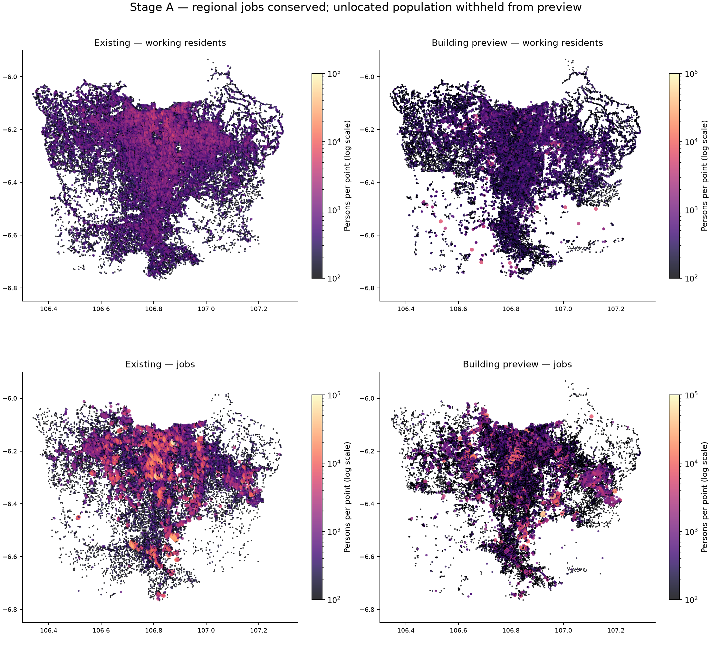
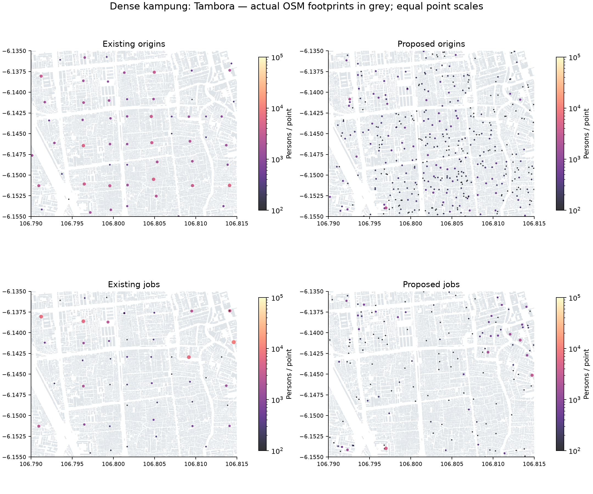
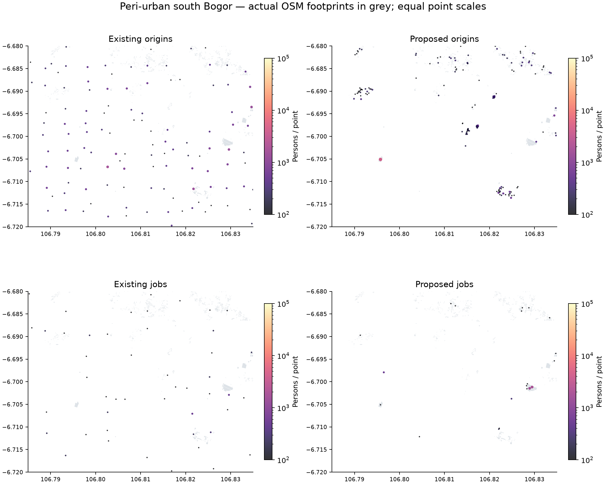

# Organic demand calibration — proposal Stage A

**Status: minta persetujuan metode, bukan persetujuan memasang preview saat ini.** Tidak ada perubahan aset game atau engine. TahapB baru boleh melakukan rebuild dan uji game sesudah disetujui.

## Desain yang diusulkan

1. Inventaris penuh OSM offline; deduplikasi parent/part dan multi-relation. Simpan provenance OSM ID, tanggal sumber, fungsi observed/inferred, levels observed/inferred, admin ID dan confidence.
2. Utamakan footprint dan fungsi nyata. Join nodePOI hanya bila berada di footprint yang cocok; jangan tempelkan POI ke bangunan terdekat tanpa uji containment. Untuk parts, union per floor band/parent agar podium dan tower tidak dihitung dua kali.
3. Estimasi usable residential/employment floor area dengan kategori fungsi. Gunakan kepadatan lingkungan sebagai inferensi morphology; bentuk cluster jalan/parsel dibutuhkan untuk membedakan kampung dan perumahan terencana secara lebih baik.
4. Distribusikan penduduk menurut kontrol paling rinci yang reliabel. 317 kelurahan langsung tetap;129 kecamatan menjadi batas keras bagi1.185 estimasi desa. Preview mempertahankan estimasi desa sebelumnya, hanya membulatkan dalam kecamatan dengan largest remainder; perubahan antar desa memerlukan coverage audit dan sensitivity.
5. Pilih anchor deterministik dari **bangunan nyata**, weighted priority sampling dengan seed20261107, reservasi tiap fungsi/desa dan tambah anchor untuk catchment jauh. Tidak memakai jitter, fixed spacing atau centroid grid. Histogram fase datar bukan target optimasi; bukti berasal dari geometri dan aktivitas yang masuk akal. Grid boleh untuk QA, tidak menentukan koordinat.
6. Agregasi kapasitas hanya dalam fungsi dan desa yang sama; radius preview maksimal500m. Produksi sebaiknya adaptif150–250m di pusat padat dan hingga500m di rural, ditambah barrier jalan/sungai/estate agar tidak berpindah antar kompleks. Jangan menyamakan ukuran semua bangunan.
7. Tetapkan inhabitants per point dalam unit1, working origins/jobs dalam unit100 secara largest remainder; keduanya konsep berbeda. Prior kerja lingkungan20% dari margin jobs melengkapi fungsi terpetakan; uji10/20/30%, bukan menganggapnya nilai observasi.
8. Susun OD regional dari distribusi anchor; kalibrasi deterrence dan lintas-batas menurut populasi survei yang sebanding. Selesaikan transport sampai titik dengan margin eksak sebelum membuat `pops`.

## Parameter preview dan ketidakpastiannya

[JSON parameter](organic-stage-a/proposed_parameters.json) merekam koefisien. Semua intensitas di bawah adalah **prior modelling relatif**, bukan angka lapangan Jabodetabek.

| Komponen | Nilai preview | Sensitivity / pekerjaan StageB |
|---|---|---|
| Usable floor area | footprint × levels ×0,8 | 0,7/0,8/0,9; cek bagian gedung dan fungsi aktif |
| Levels bila hilang | lowrise1,5;apartment6;office3;factory/warehouse1;government/school2;hospital/hotel4 | 0,5×/1×/2× inferred floor area; jangan ubah levels observed tanpa alasan |
| Hunian | 95% usable lowrise/apartment;60% mixed | Hunian aktif/occupancy tidak diketahui; uji0,8–1 faktor tambahan |
| Dense lowrise | 18m²/person jika footprint<150m² dan radius8 tetangga<50m | Inferensi morphology; bukan label kampung teramati |
| Lowrise lain / sparse / apartment | 25 /30 /32m²/person | Uji±25%; apartment tidak otomatis lebih padat daripada kampung |
| Office / government | 20 /25m² per relative worker | 12–30 /18–40 |
| Factory / warehouse | 75 /140m² | 40–120 /80–220; tenaga kerja per perusahaan bila tersedia |
| Retail / market | 35 /45m² | 20–70 /25–90; pisahkan podium dan area sirkulasi |
| University / school / hospital | 50 /70 /45m² | 30–100 /40–120 /30–90; jangan hitung mahasiswa/pasien sebagai workers |
| Hotel / exhibition | 100 /140m² | Hotel idealnya beds/rooms dan kelas layanan; hall tidak seperti kantor |
| Neighborhood jobs | 20% regional jobs melalui residential capacity | 10/20/30%; bukan survei informal sector |
| Road mask | 8m dari centerline major/highway normal | 4/8/12m; bridge/tunnel dibedakan |
| Road access | Jarak ke semua ruas dipantau; tidak otomatis drop>250m | Private/local roads tidak lengkap; buat fallback entrance/parcel dahulu |
| Anchor count | 71,901 | Bandingkan sekitar40k/60k/80k dengan displacement berbobot dan game performance |


[Employment Density Guide2015 dari HCA pada situs Westminster](https://www.westminster.gov.uk/sites/default/files/media/documents/Employment%20density%20guide%20%28Homes%20and%20Communities%20Agency%2C%20November%202015%29.pdf) menunjukkan bahwa densitas berbeda menurut fungsi dan basis area. Benchmark luar negeri ini hanya pemeriksaan kewajaran metode; koefisien preview di atas bukan angka yang diambil sebagai observasi Jakarta, dan NIA/GIA/GEA tidak boleh dicampur begitu saja.

## Fallback coverage dan konservasi

Inventaris audit memiliki5.111.995 footprint>=10m² di ekstrak complete-ways, termasuk bangunan di luar admin yang ikut tersalin. Setelah admin/mask pantai terdapat sekitar4,50juta kandidat sebelum koreksi fungsi tambahan. Jumlah ini tidak sama dengan bangunan game30.000 maupun hitungan preparasi lama yang memakai filter lain.

633,996 penduduk dan 242,100 pekerja di75 desa belum memiliki lokasi yang layak:52 tanpa footprint eligible dan sisanya tanpa kapasitas hunian yang teridentifikasi. Mereka berada dalam `unlocated_allocations`; tidak ditempatkan di pabrik/tempat ibadah hanya untuk menutup total.

Urutan penyelesaian setelah approval: validasi batas admin dan footprint; cari developed residential parcels/kompleks yang nyata; periksa coverage built-up dan hunian dengan sumber citra/permukiman bertanggal; gunakan titik dalam **parcel developed yang terhubung jalan**, di luar carriageway/mask, masih di desa kontrol yang sama. Bila buktinya belum cukup, ledger tetap pending dan build produksi gagal dengan alasan eksplisit. Jangan pindahkan ke desa tetangga atau ratakan seluruh poligon. Lapisan built-up historis hanya fallback evidence dan harus diberi tahun, bukan dianggap2026 otomatis.

**Kontrol446 dan total32.615.007 sudah eksak ketika ledger dihitung.** Titik terlokasi sendiri hanya31,981,011 inhabitants dan12,404,600 origins; sehingga preview tidak memenuhi deploy gate “semua demand mempunyai geografi”. Jobs12.646.700 tetap eksak di13region. [Hasil kontrol](organic-stage-a/population_control_checks.json) membedakan `located` dari `allocated_including_unlocated`.

## OD yang diusulkan dan yang benar-benar dihitung

Dihitung:12 matriks13×13; decay12/18/30km, tanpa penyesuaian serta target lintas batas30/40/50%. Kernel memakai256 sampel proportional-to-mass dari home/jobs anchor tiap region, bukan jarak antar centroid. IPF memastikan margin; LP rounding pada unit100 mempertahankan total baris/kolom eksak. Jumlah lintasregion minimum dari ketimpangan margin2.071.500.

| Skenario | Lintas region | Diagonal multiplier | P50 / P90 jarak bersyarat km |
|---|---|---|---|
| tau12_unadjusted | 74.3% | 1.00 | 14.1 / 31.6 |
| tau12_cross30 | 30.0% | 12.52 | 8.7 / 23.7 |
| tau12_cross40 | 40.0% | 6.17 | 9.7 / 25.7 |
| tau12_cross50 | 50.0% | 3.60 | 10.9 / 27.5 |
| tau18_unadjusted | 80.2% | 1.00 | 17.5 / 38.1 |
| tau18_cross30 | 30.0% | 17.76 | 9.6 / 27.1 |
| tau18_cross40 | 40.0% | 8.75 | 11.0 / 29.8 |
| tau18_cross50 | 50.0% | 5.13 | 12.5 / 32.1 |
| tau30_unadjusted | 85.0% | 1.00 | 21.1 / 43.7 |
| tau30_cross30 | 30.0% | 25.07 | 10.6 / 30.6 |
| tau30_cross40 | 40.0% | 12.30 | 12.2 / 33.8 |
| tau30_cross50 | 50.0% | 7.22 | 14.0 / 36.6 |


Jarak pada tabel adalah distribusi **sampel pasangan bersyarat** yang dibobot OD regional; bukan micro-OD yang mempertahankan margin setiap point. Jangan membandingkannya sebagai perbaikan tervalidasi terhadap OD lama. Asal242,100 yang belum terlokasi juga belum terwakili di kernel spasial. Tidak ada `pops` baru yang dibuat.

Rekomendasi review:`tau18_cross40`, sambil memeriksa30/50% dan tabel BPS.40% adalah pilihan sensitivitas yang disengaja, bukan fitted estimate2026. Preferensi diagonal tidak boleh menjadi satu-satunya cara kalibrasi: orang yang tinggal dan bekerja dekat perbatasan region tetap perlu trips lintas batas yang murah. StageB perlu jaringan/biaya dan observed OD agar efek administratif tidak menciptakan discontinuity.

Transport StageB yang mempertahankan semua margin: (a) tiap origin-region membagi supply point ke13 job-region dengan quota OD regional; (b) tiap job-region membagi demand point ke13 origin-region dengan quota yang sama; (c) dalam setiap pasangan region, cocokkan supply/demand teralokasi melalui sparse min-cost transport, menambah edges bila tidak feasible. Dengan demikian point home/jobs dan13×13 quota tidak bergeser oleh sampling. Simpan seed, cost, tie-break dan integer unit. Uji flows Depok/Bekasi→Jakarta, Tangerang/Tangsel→CBD/lokal, residential→Cikarang, BSD/Alam Sutera serta cross-suburban tanpa CBD; jangan menetapkan flows tersebut sebagai observasi.

Driving distance/time lama tetap proksi, bukan routing. Proposal StageB memakai jaringan jalan dan penalti akses/kemacetan yang dikalibrasi; bila belum tersedia, tampilkan status proxy secara eksplisit dan uji detour1,2/1,35/1,6 serta kecepatan18/24/30km/h. Tidak menafsirkan waktu sintetis sebagai pengukuran perjalanan.

## Performa dan kompatibilitas1.7.2

| Pemeriksaan | Hasil / batas |
|---|---|
| Anchor count | 71,901 (2.88× baseline) |
| JSON allocation dengan metadata | 31,536,013 bytes |
| Gzip allocation | 2,742,842 bytes |
| Parse JSON Python,3run | 0.166s / 0.982s / 0.157s |
| Ekstraksi inventaris penuh | 503,1s; scratchSQLite~813MB; tidak dimasukkan paket game |
| Klasifikasi+preview full run teramati | sekitar124s sebelum koreksi/coast/cached pass; bukan benchmark game |
| Cached allocation terakhir | 17.6s; peak RSS 1.03GiB |
| Index bangunan / PMTiles | Tidak dibesarkan atau diubah |
| Engine schema | points[id,location,jobs,residents,popIds]; pops[id,size,residenceId,jobId,drivingSeconds,drivingDistance] |
| Bukti runtime baru | Belum ada; StageA tidak memasang demand atau memodifikasi engine |


Jumlah anchor baru mengurangi displacement dan mempertahankan fungsi; tidak ada hard engine limit yang ditemukan dalam pemeriksaan format, tetapi itu **bukan jaminan** performa. Allocation JSON berisi provenance dan ledger, bukan format demand engine. Jangan salin file ini ke `demand_data.json.gz`. `population` metadata tidak boleh dimasukkan sebagai working `residents` secara langsung.

Gate StageB: unique IDs/valid references, point totals sama dengan pop-derived totals, exact source-level population dan point/regional OD margins; seluruh ledger lokasi selesai; zero unreviewed mask hits; documented job outliers; reproducibility byte-identical asset; lalu uji load/save, worker/resident overlays, memory, pan/zoom dan frame time pada skenario40k/60k/80k. Laporkan hasil aktual; jangan menjanjikan FPS dari benchmark Python.

## Reproduksi dan deliverables

Snapshot OSM:[Geofabrik Java](https://download.geofabrik.de/asia/indonesia/java.html),2026-11-05T21:23:02Z. SHA256 PBF:`5d3fdd1b8883ddc3d9e42c3aaf375a67863efa89f4e7b373f1967059ca324122`. OSM©OpenStreetMap contributors, ODbL; attribution tetap diperlukan. [Environment dan versi](organic-stage-a/reproduction_environment.json). Source download/raw full inventory tetap di scratch, tidak menambah ukuran aset game.

Dari workspace, gunakan Python environment dengan versi paket pada environment JSON:

```sh
osmium extract --strategy=complete_ways --bbox=106.30,-6.85,107.35,-5.90 work/organic-audit/java.osm.pbf -o work/organic-audit/jabodetabek.osm.pbf
osmium tags-filter work/organic-audit/jabodetabek.osm.pbf wr/building wr/building:part wr/landuse wr/natural wr/leisure wr/aeroway wr/amenity wr/office wr/shop wr/tourism n/amenity n/office n/shop n/tourism -o work/organic-audit/activity.osm.pbf
work/map-venv/bin/python outputs/jabodetabek-mod/scripts/audit/extract_inventory.py work/organic-audit/activity.osm.pbf work/organic-audit/inventory.sqlite
work/map-venv/bin/python outputs/jabodetabek-mod/scripts/audit/baseline.py
work/map-venv/bin/python outputs/jabodetabek-mod/scripts/audit/water_mask.py work/organic-audit/packaged_water.wkb
work/map-venv/bin/python outputs/jabodetabek-mod/scripts/audit/propose.py work/organic-audit/inventory.sqlite
work/map-venv/bin/python outputs/jabodetabek-mod/scripts/audit/od_preview.py
work/map-venv/bin/python outputs/jabodetabek-mod/scripts/audit/visualize.py work/organic-audit/inventory.sqlite
work/map-venv/bin/python outputs/jabodetabek-mod/scripts/audit/verify_stage_a.py work/organic-audit
work/map-venv/bin/python outputs/jabodetabek-mod/scripts/audit/write_reports.py
```

`extract_inventory.py` menolak append keDB yang sudah ada. Untuk rerun allocation memakai kandidat scratch yang sama, tambahkan `--reuse`. Baseline hash manifest harus dibuat sebelum perubahan dari tracked files commit baseline;44 hash awal diperiksa ulang oleh verifier. Semua output proposal berada di `docs/organic-stage-a`, bukan `assets/`.

File utama: [allocationsJSON.gz](organic-stage-a/proposed_allocations.json.gz), [ringkasan desaCSV](organic-stage-a/proposed_village_allocations.csv), [parameterJSON](organic-stage-a/proposed_parameters.json), [skenarioOD dan keterbatasan](organic-stage-a/od_scenarios.json), [validasi](organic-stage-a/validation.json), [coverage gaps](organic-stage-a/coverage_gaps.csv) dan [uji determinisme](organic-stage-a/reproducibility.json). `baseline_arrays.npz`, `proposed_arrays.npz` dan `od_scenarios.npz` menyimpan arrays untuk reproduksi grafik. Ledger lokasi berada di allocationJSON; confidence function/levels dan OSM ID ada pada setiap anchor. Metadata kapasitas adalah agregat cluster, bukan estimasi staffing gedung anchor tunggal.





Persetujuan yang diminta: lanjutkan StageB untuk melengkapi coverage/fungsi dan menerapkan metode konservatif ini, dengan validasi sebelum penggantian aset. Preview dan angka distribusi lokal belum dianggap final. Instruksi pengguna sendiri mensyaratkan “StageB—Implementation after approval”; karena itu rebuild produksi dan in-game verification belum dilakukan.
