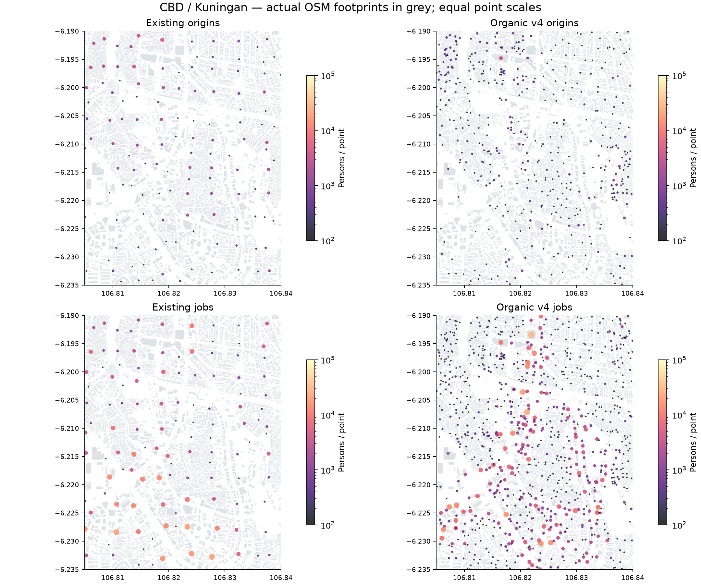
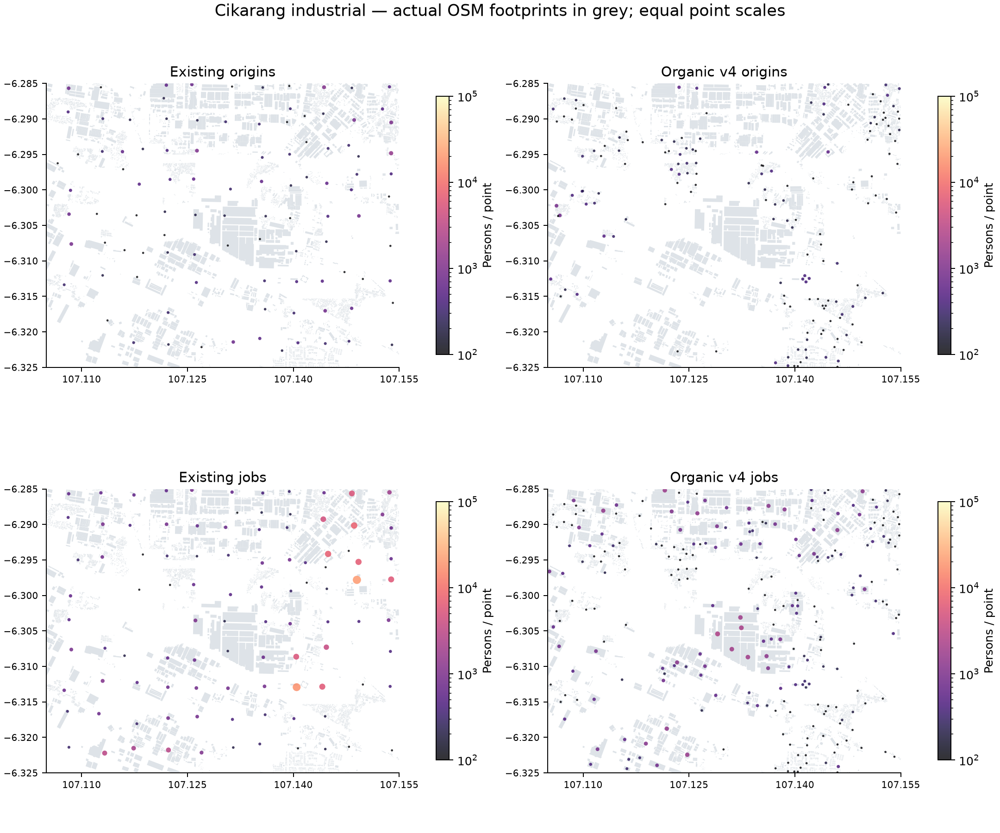
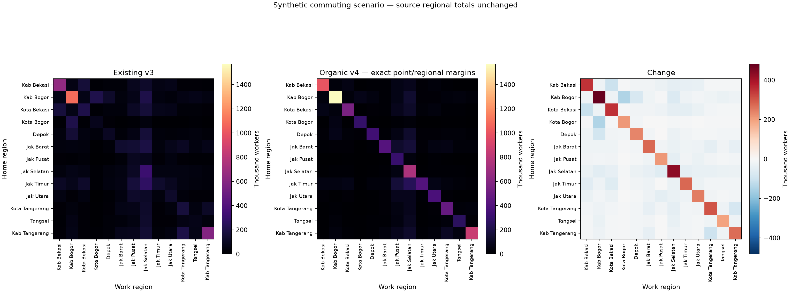
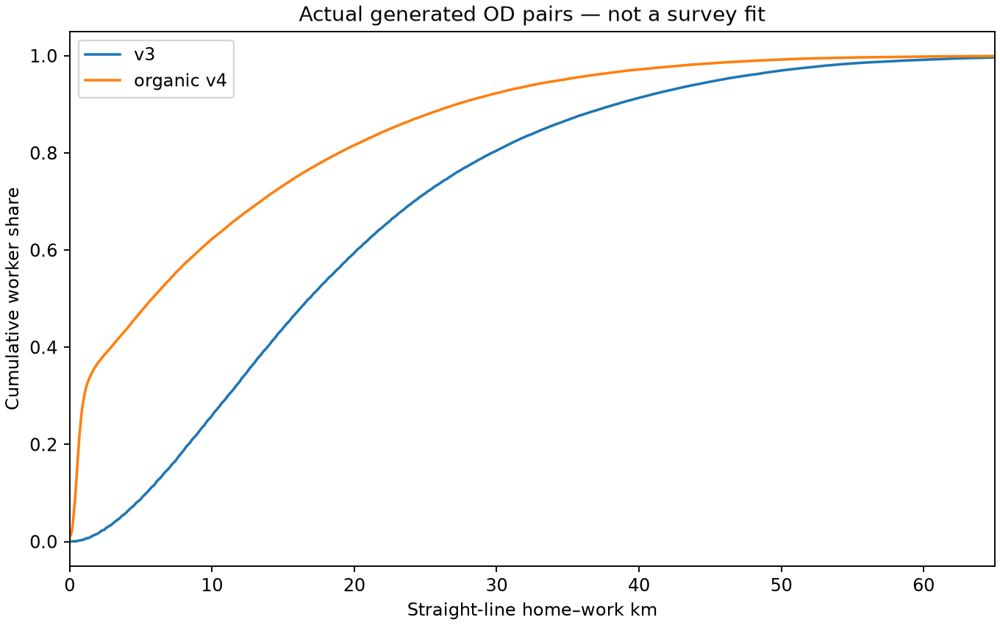
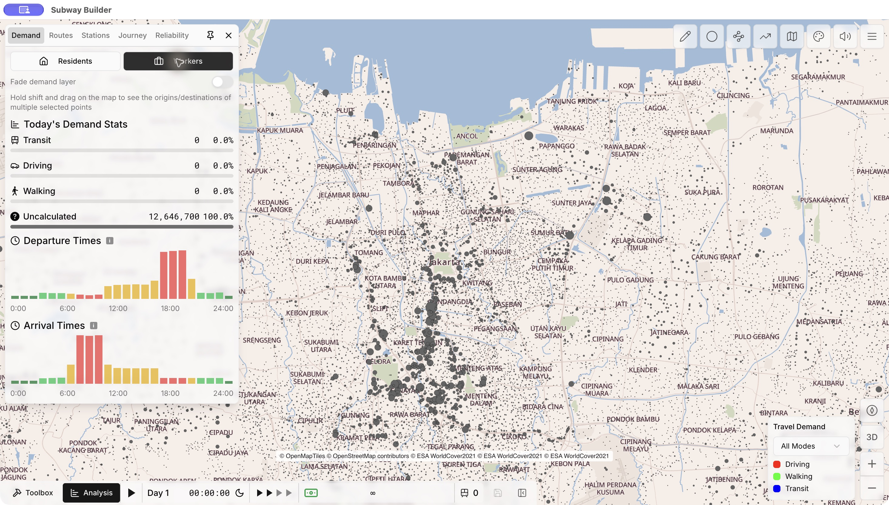

# Organic demand v4 — hasil Stage B

**Selesai dan terpasang lokal**, modv0.2.1. Diuji di **Subway Builder1.7.2**, termasuk fresh sandbox, Residents/Workers, pemilihan titik, pan/zoom dan save/load. Engine game tidak diubah. Aset v3 disimpan untuk rollback.

## Hasil utama

| Ukuran | v3 | v4 |
|---|---|---|
| Inhabitants yang dikontrol | 32,615,007 | 32,615,007 |
| Penduduk belum terlokasi | Tidak diperiksa | 0 |
| Kontrol resmi | 446 | 446 eksak di lokasi |
| Working origins dan jobs | 12,646,700 | 12,646,700 masing-masing |
| Anchor alokasi inhabitants/workplaces | 24,943 | 115,929 |
| Titik aktif engine | 24,943 | 78,404 |
| Grup pekerja100orang | 126,467 | 126,467 |
| Jobs terbesar pada satu anchor | 164,600 | 32,700 |
| Komuter lintas13region | 8,886,200 /70.3% | 5,058,600 /40.0% |
| Median /p90 jarak lurus | 16.81 /38.37km | 5.78 /27.16km |
| Gzip demand | 3,094,248bytes | 3,895,853bytes |

78,404 adalah titik aktif engine, sedangkan115,929 anchor juga mencatat penduduk yang tidak menjadi pekerja dan sebagian menerima0unit pekerja setelah rounding.1002 titik engine tambahan adalah destination alias di koordinat yang sama untuk commute on-site; ini memenuhi aturan ID asal≠tujuan tanpa menggeser lokasi. 2koordinat anchor kebetulan sama dari geometri sumber; bukan jitter atau lattice buatan.

## Geografi, coverage dan kapasitas

Koordinat primer mengikuti point-on-surface bangunan pada inventaris OSM penuh, bukan index ringan30.000 bangunan. Class fungsi dan desa harus sama dalam agregasi. Radius maksimum200m untuk dense low-rise,350m untuk urban lainnya dan500m untuk sparse/periurban; garis dari kontributor ke anchor tidak boleh menyeberang jalan utama normal atau air. Perpindahan kontributor p50/p90/p99 sekitar68.1/126.3/185.9m. Bukti membership tersimpan di scratch `cluster_members.npz`; provenance anchor tersedia di [allocationJSON](organic-stage-b/proposed_allocations.json.gz).

Pengayaan: 7,227 POI dan141 dari526 situs industri resmi berada langsung dalam footprint eligible. Yang tidak cocok tidak dipaksa ke bangunan terdekat. 429 parts dengan levels cocok≥90% di parent; union per floor-band memperbaiki125 parent. 89 bangunan memakai median levels bangunan berfungsi sama, berukuran sebanding, dalam500m; tetap dilabeli inferred. 12,773 footprint generik>=800m² memakai prior mixed-use60%hunian/40%aktivitas, dengan90m² per relative worker. Ini inferensi morphology, bukan fungsi gedung yang terukur. 10893bangunan generik kecil pada konteks industrial landuse diklasifikasikan mixed-use bila footprint<180m², delapan tetangga dalam60m dan WorldPop2025>=10orang/sel100m; fungsi eksplisit pabrik/office tidak ditimpa. Ini mencegah kawasan campuran dibaca sebagai seluruh bangunannya pabrik. Kasus Jatake memperlihatkan poligon industri OSMw515754822 bertumpang tindih dengan sekitar40,6ha landuse permukiman OSMw516581429; dukungan hunian yang lebih spesifik itulah yang dipakai, bersama built-up dan akses jalan, tanpa menaikkan kapasitas rumah secara sewenang-wenang.

339 wilayah mendapat dukungan50,749 parcel fallback yang telah disaring, mencakup gap awal dan263desa yang ditandai berisiko kekurangan coverage. [Daftar risiko awal yang dibekukan untuk reproduksi](../sources/organic/coverage_support.json). Hanya11,154 anchor parcel di339 desa benar-benar diperlukan pada alokasi akhir, menampung4,665,385 inhabitants dan1,822,700 working origins. Sisanya menggunakan bangunan. Semua footprint OSM yang sudah ada dikurangi dahulu dengan toleransi2m, sehingga suplementasi tidak menghitung atap yang sama dua kali. WorldPop2025 positif menjadi dukungan tambahan. Pada overlap landuse, permukiman terpetakan mendapat prioritas sebagai dukungan hunian. Di luar dukungan residential itu, konteks industrial hanya menerima parcel kecil<=1200m² dengan WorldPop>=10orang/sel100m; ini inferensi permukiman kecil dalam kawasan campuran, bukan rumah yang ditempatkan pada footprint pabrik terpetakan. Fallback merupakan komponen built-up WorldCover2021 yang di-clip ke wilayah, dikurangi air/hutan/airside/fasilitas nonhunian/badan jalan, dan harus berada dalam200m dari jalan. Titik diambil di sisi akses parcel pada interior yang valid, mengikuti geometri jalan; bukan pusat sel500m atau random scatter.

[Review kapasitas hunian](organic-stage-b/residential_capacity_review.json) setelah suplementasi menandai0desa dengan rasio penduduk terhadap prior kapasitas>5. Rasio itu adalah diagnostik coverage/floor/occupancy, bukan overcrowding yang diukur; kontrol penduduk tetap dipertahankan di desa asal.

**WorldCover adalah sumber2021**, bukan observasi2026. Poligon built-up tidak membuktikan fungsi hunian atau okupansi bangunan saat ini. [Sumber, SHA dan atribusi](../sources/organic/source_manifest.json) serta [poligon fallback](organic-stage-b/fallback_parcels.geojson.gz) menyimpan batas ketidakpastian itu.

## Perubahan parameter yang diperlukan selama implementasi

Pilot memperlihatkan satu mall dapat menerima67.100 jobs karena kapasitas fungsi yang jarang dipetakan dinormalisasi>10kali pada Bogor. Itu tidak diterima sebagai jumlah pekerja riil. Komponen fungsi/lantai sekarang dibatasi pada maksimum2×kapasitas relatif, kurang-lebih ujung intensitas tinggi pada rentang StageA. Sisa regional tetap dipertahankan melalui prior pekerjaan lingkungan/mixed-use yang belum terklasifikasi. Batas ini bekerja pada komponen kapasitas, **bukan cap total jobs seragam per bangunan**.

Porsi residual tersebut berbeda menurut region dan harus dibaca sebagai ukuran ketidaklengkapan fungsi yang terpetakan—**bukan persentase informal-sector atau home-working yang teramati**:

| Region | Jobs regional tetap | Komponen lingkungan belum terklasifikasi |
|---|---|---|
| Bekasi | 1,255,400 | 56.9% |
| Bogor | 1,963,600 | 83.3% |
| Kota Bekasi | 840,200 | 73.5% |
| Kota Bogor | 437,400 | 63.4% |
| Kota Depok | 529,100 | 66.2% |
| Kota Jakarta Barat | 634,000 | 20.0% |
| Kota Jakarta Pusat | 1,199,200 | 22.4% |
| Kota Jakarta Selatan | 2,080,800 | 43.8% |
| Kota Jakarta Timur | 582,700 | 26.1% |
| Kota Jakarta Utara | 706,600 | 20.0% |
| Kota Tangerang | 852,700 | 73.5% |
| Kota Tangerang Selatan | 522,100 | 49.9% |
| Tangerang | 1,042,900 | 47.3% |

Terutama Bogor masih sangat bergantung pada prior. Kontrol regional historis/registrasi dipertahankan sesuai urutan kalibrasi yang disetujui; tidak dinyatakan sebagai physical-workplace census2026. Sebelum rebalancing regional berikutnya, diperlukan staffing/lokasi fisik perusahaan dan tabel workplace komuter yang sebanding. [Regularisasi lengkap](organic-stage-b/employment_capacity_regularization.json).

Sembilan skenario ceiling1,5/2/3 × minimum-komponen-lingkungan10/20/30% sudah dihitung; semuanya menjaga jobs12.646.700. Nilai jobs maksimum per anchor bervariasi24,500–37,900. [Sensitivity per pusat dan region](organic-stage-b/capacity_sensitivity.json) adalah skenario ketidakpastian, bukan confidence interval.

## Pusat pekerjaan sebelum/sesudah

| Prioritas / pusat | Jobsv3 | Jobsv4 |
|---|---|---|
| P0 Sudirman–Thamrin–SCBD | 820,300 | 1,525,600 |
| P0 Kuningan–Mega Kuningan–Rasuna Said | 331,000 | 642,800 |
| P0 Gatot Subroto–Semanggi | 516,900 | 724,800 |
| P0 TB Simatupang–Cilandak | 615,300 | 369,600 |
| P0 Cikarang–Cibitung–MM2100–Jababeka | 904,800 | 870,900 |
| P1 BSD–Serpong | 277,800 | 224,300 |
| P1 Alam Sutera–Gading Serpong | 323,900 | 266,800 |
| P1 Sunter–Kelapa Gading | 691,200 | 495,000 |
| P1 Cakung–Pulogadung | 449,600 | 347,600 |
| P1 Slipi–Palmerah–Grogol | 458,900 | 386,300 |
| P1 Pluit–PIK–Penjaringan | 249,500 | 295,400 |
| P1 Jatiuwung–Batuceper–Balaraja | 1,117,600 | 941,600 |
| P2 Margonda–Depok | 333,700 | 150,700 |
| P2 Bekasi Selatan–Summarecon | 254,200 | 232,100 |
| P2 Bogor Tengah–Baranangsiang | 215,400 | 184,400 |

Jendela saling overlap dan bukan batas pusat ekonomi; tidak boleh dijumlahkan. Tidak ada boost berdasarkan nama pusat. Angka adalah model alokasi, bukan staffing yang diobservasi. [CSV](organic-stage-b/employment_centers.csv) dan [cluster tambahan](organic-stage-b/discovered_clusters.json) membantu audit lanjutan.

## OD dan waktu perjalanan

18km decay dengan skenario40% lintas region dipertahankan sebagai pilihan review StageA.40% **bukan fitted rate2026**. IPF membentuk point-to-region probabilities, kemudian min-cost integer rounding dan matching jarang dalam169 pasangan region menjaga semua point margins serta13×13 quota. Seed20261107, stochastic cost scale6km; maksimal32 nearest/random candidates cukup pada snapshot ini. Setiap grup tetap100orang. Rounding quota memberi5,058,600 pekerja lintas region(39.9994%).

Tidak ada origin/destination yang hilang akibat local weighted sampling seperti generator lama. [Pemeriksaan independen](organic-stage-b/validation.json) merekonstruksi margin dan `popIds` dari seluruh126.467 grup, termasuk alias on-site. [Matriks OD](organic-stage-b/regional_od.csv) dan [pasangan titik](organic-stage-b/od_pairs.npz) adalah hasil aktual generator, bukan sampel kernel StageA.

DrivingDistance/Seconds tetap **proksi**1,35×jarak lurus,24km/jam+180s. Sampel96pasangan berbobot demand pada graph2.574.993 node/2.716.500 edge jalan mendapat95pasangan terhubung; median detour1.33,p901.84. Ini mendukung faktor median kira-kira1,35 tetapi menunjukkan ekor yang lebih panjang. Semua jalan minor dimasukkan; access/turn restrictions dan kemacetan tidak tersedia. 1pasangan tak terhubung adalah keterbatasan graph, bukan bukti tidak ada jalan di kenyataan. **Jangan sebut setiap trip sudah diroute pada jalan.** [Detail sampel](organic-stage-b/route_sample.json).

## QA dan runtime

446 kontrol penduduk lulus dengan residual0; asal/tujuan per titik dan region eksak; seluruh referensi/linkpop valid;104,775 anchor berada di footprint sumber,11,154 di parcel valid; semua di admin dan bbox yang benar. Nol hit terhadap mask air pantai/daratan, hutan/wetland, airside dan buffer jalan utama8m yang tersedia. Ini validasi dataset, bukan survei lapangan atau jaminan semua objek terpetakan.

Dua generasi demand identik byte demi byte. SHA256 terpasang:`8c6f5a75ec22fac174fd664359baccde19ed832c6a2dea3cb2bcd57e61fd4808`. Validator paket asli juga lulus:30.000 indexbuildings,414.732 roads,454aerowayfeatures,78,404 points,126.467groups. Map tiles, roads, aeroways, foundations dan building index tidak dibesarkan/diubah. Net tambahan demand801,605bytes(~0.76MiB).

Pengujian UI1.7.2 selesai untuk modv0.2.1: fresh sandbox, Residents/Workers, total12.646.700, titik1,300workers/13pops, pan/zoom, save baru **Jabodetabek Organic v4 Final QA**, lalu load dan pengecekan total/layer lagi. Save yang sudah ada tidak ditimpa. [Catatan runtime](organic-stage-b/runtime_verification.json).

RSS snapshot proses game: 334.1MiB sebelum dan1861.0MiB sesudah. Viewport/cache berbeda dan mod lain aktif; ini bukan benchmark terisolasi, pengukuran FPS, atau simulasi jaringan besar. Respons UI diperiksa secara kualitatif.

## File, reproduksi dan rollback

- [Data penduduk/pekerjaan per1.502desaCSV](organic-stage-b/proposed_village_allocations.csv), [kontrol446](organic-stage-b/population_control_checks.json), [metadata alokasi lengkap](organic-stage-b/proposed_allocations.json.gz).
- Aset runtime:[demand_data.json.gz](../assets/JKT/demand_data.json.gz), [metodev4](../assets/JKT/demand-method.json), [status build](../BUILD_STATUS.json).
- Raw PBF, SQLite penuh, WorldCover34MB dan candidate arrays tetap di scratch; tidak dimasukkan payload game.
- Dari workspace:`work/map-venv/bin/python outputs/jabodetabek-mod/scripts/organic/rebuild.py`. Memerlukan inventaris StageA, tile WorldCover dan cropWorldPop2025 yang SHA-nya tercatat. Versi paket:[environment.json](organic-stage-b/environment.json). Default staging; `--install` memasang hanya setelah gate dan reproducibility lulus. Uji UI wajib diulangi sesudah install; script tidak boleh mengklaim in-game verified otomatis.
- [Rollbackv3](organic-stage-b/rollback-v3/manifest.json): salin kembali file pada manifest ke path relatif repo yang sama, lalu hot-reload/scan mod dan buka city/savev3. Jangan menjalankan generator lama tanpa sengaja ketika hanya ingin memulihkan aset. Docs/provenancev4 boleh tetap disimpan.

Perubahan source/asset ini masih lokal. Laporan StageA tetap tersedia sebagai baseline; angka dan file preview StageA tidak menggantikan hasil StageB ini.
