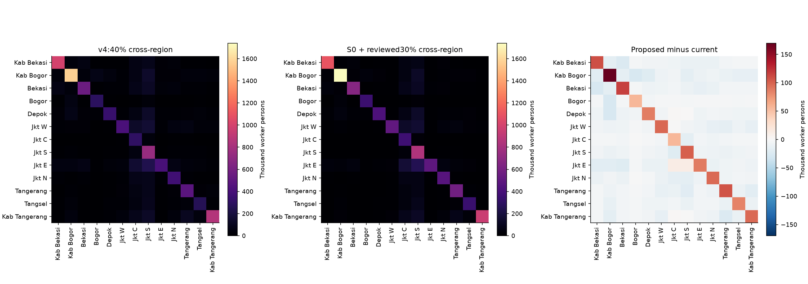

# Proposal kalibrasi Organic v4.1

**Stage A — audit dan proposal, 8 November 2026. Belum diinstal dan belum diuji di game.** Produksi tetap Organic v4 / mod 0.2.1, commit `dfec7f2`. Tidak ada perubahan engine, peta, atau aset game.

## Pilihan yang konkret untuk ditinjau

**Rekomendasi utama: setujui koreksi spasialS0.** Untuk OD,30% adalah opsi review yang memerlukan pilihan eksplisit;40% tersedia sebagai kontrol agar perubahan lokasi tidak tercampur dengan perubahan mobilitas. **S1 tidak direkomendasikan sebagai release default** tanpa bukti staffing fasilitas tambahan. Persetujuan S0 saja dapat mempertahankan OD40; perubahan ke OD30 harus dipilih terpisah.

| Komponen | Current | Proposal / status |
|---|---|---|
| Seluruh penduduk | 32,615,007 | Tetap;446kontrol dan1,502desa cocok |
| Asal pekerja / jobs | 12,646,700 | Tetap; regional destinations dipertahankan |
| 33 anchor salah/terindikasi fungsi | Penduduk pada parkir/tangki/operasional | S0: pindah12,142inhabitants dalam desa yang sama; worker origins berpindah4,800 setelah rounding |
| HanggarCGK | 0jobs pada6hangaranchor | S0:pulihkan6interior;2,200modeljobs total pada prior transport150m² |
| JobsCGK dalam aerodrome | 13,500 | S0:15,000; bukan klaim workforce sebenarnya |
| Jobs yang berganti anchor | — | S0:5,700 half-L1, total region tetap |
| Floor/ceiling priors | Factory75;warehouse140;transport150;ceiling2 | S0 tetap;S1 sensitivity terpisah50/180/80/100 |
| OD cross-region | 40.00% | Review30.00% atau pertahankan40%; exact point candidates keduanya tersedia |
| Distance decay | 18km | Tetap pada kandidat;12/18/30 diuji regional |
| Demografi/nonwork | Tidak lengkap | Audit/source plan saja; tidak ditambah tanpa approval dan attendance/physical-workplace data |

S0 adalah preview yang sengaja mempertahankan cluster lama. Sebelum implementasi release, semua anggota cluster yang sumber anchornya salah fungsi perlu direklasifikasi; hindari satu anchor kantor/parkir menampung cluster mixed/hunian dari tetangganya. Tambahkan facility boundary sebagai barrier agregasi dan periksa worker-access side pada hanggar. Jika hasil rebuild mengubah lokasi atau jumlah titik, hitung ulang seluruh tabel dan minta review jika ruang lingkup berubah material; jangan menyamakan preview ini dengan release otomatis.

## OD dan definisi pembanding

BPS2023 memisahkan3,614,673 pekerja-komuter dan800,301 pelajar-komuter lintas kab/kota. Pembagian angka pekerja itu dengan total model adalah28.58%, tetapi berbeda tahun dan universe sehingga **bukan observed share untuk model2025**. Skenario30%lebih dekat secara besaran, tanpa mengklaim fit. Jumlah lintasregion30%adalah3,793,900, bukan3.6juta all-workertrips. DKI terdiri dari lima kota sehingga perjalanan JakartaSelatan→JakartaPusat juga cross-region.

| Decay km | Cross scenario | Actual cross workers | Origin residual | Destination residual |
|---|---|---|---|---|
| 12 | 30.0% | 3,793,900 | 0 | 0 |
| 12 | 35.0% | 4,426,500 | 0 | 0 |
| 12 | 40.0% | 5,058,800 | 0 | 0 |
| 18 | 30.0% | 3,793,900 | 0 | 0 |
| 18 | 35.0% | 4,426,400 | 0 | 0 |
| 18 | 40.0% | 5,058,800 | 0 | 0 |
| 30 | 30.0% | 3,794,100 | 0 | 0 |
| 30 | 35.0% | 4,426,300 | 0 | 0 |
| 30 | 40.0% | 5,058,600 | 0 | 0 |

Sample256per region/role membentuk kernel; region IPF+integer transport menjaga margin. Pair-level sparse min-cost matching mempertahankan semua marginpoint; cost noise6km tetap sensitivitas, bukan observed route choice. Pemilihan30% menambah diagonal preference dari baseline, sehingga self-containment lokal perlu diuji terhadap survei asal–tujuan yang harmonis. Seluruh model tidak diarahkan ke CBD: [asal Bekasi/Depok/Tangerang/Bogor→Jakarta dan lokal](organic-v41/regional_corridor_od.csv), [koridor lokal Nambo/Cikarang/BSD dan industri](organic-v41/local_corridor_od.csv). OD40 kandidat penuh mengisolasi efekS0 dari perubahan persentase.

## Kinerja dan kompatibilitas

| Metrik | v4 produksi | S0+OD30 | S0+OD40 kontrol |
|---|---|---|---|
| Active engine points | 78404 | 78526 | 78407 |
| Allocation anchors | 115929 | 115935 | 115935 |
| Commuter groups | 126467 | 126467 | 126467 |
| Gzip bytes | 3895853 | 3797067 | 3895337 |
| Fresh Python parse seconds | 0.169 | 0.159 | 0.158 |
| Fresh Python peakRSS MiB | 208.1 | 209.2 | 208.0 |
| In-game render/save/load | Verified1.7.2 | Not run /StageA | Not run /StageA |

Generation cached full-point candidateOD30:6.03s; audit cached inventory:33.87s; independent spatial/schema gate:12.37s. Python parse measurements are one fresh process each with warm OS cache, **not game memory/FPS benchmarks**.122additional active enginepoints atOD30 arise chiefly from different pair matching/on-site split and rounding, not a point-density target. OD40 has3additional activepoints; underlying geographical anchors only add6hangars.

The production v4 game was tested1.7.2 with save/load previously. StageA intentionally does not load these candidate files into the installed city or claim proposed save/load compatibility. Static schema/link/margin checks passed forOD30; full point marginals also checked forOD40. Existing tiles/index/roads unchanged. [Performance JSON](organic-v41/performance.json), [static validation](organic-v41/validation.json).

## StageB setelah persetujuan

1. PilihS0 dan opsiOD30/OD40 secara eksplisit;S1 hanya bila disetujui sebagai eksperimen.
2. Perbaiki klasifikasi konstituen cluster, boundary fasilitas, dan entry point pekerja; pertahankan semua kontrol yang disetujui.
3. Rebuild staging, ulang conservation/geometry/OD tests serta reproducibility; simpan manifest dan rollback v4 padaSHAproduksi saat ini.
4. Install hanya hasil approved; cold-load sandbox1.7.2, Workers/Residents, poin/OD, pan/zoom, waktu/memori kualitatif;save/load dengan nama baru.
5. Perbarui metadata hanya setelah bukti UI aktual; engine tidak diubah. Perubahan demografi/regional totals/nonwork tetap butuh skenario dan approval terpisah.

Aset produksi tidak disentuh padaStageA. Hash demand tetap`8c6f5a75ec22fac174fd664359baccde19ed832c6a2dea3cb2bcd57e61fd4808`. Proteksi seluruh path game tercatat pada[completion checks](organic-v41/completion_checks.json).

## Berkas review dan reproduksi

- [Point current/S0/S1](organic-v41/point_comparison.csv.gz), [desa](organic-v41/village_comparison.csv), [kawasan](organic-v41/area_comparison.csv), [regional](organic-v41/regional_comparison.csv).
- [Kandidat alokasiS0](organic-v41/proposed_allocations.json.gz), [S1 pilot](organic-v41/pilot_allocations.json.gz).
- [Kandidat demandOD30](organic-v41/candidate-demand.json.gz), [kontrolOD40](organic-v41/od40/candidate-demand.json.gz). **Review files only; not installed.**
- [Parameter](organic-v41/scenario_parameters.json), [source evidence](organic-v41/source_evidence.json), [detail semua area](organic-v41/AREA_DETAILS.md).

Jalankan dari workspace dengan Pythonvenv yang telah tercatat: `audit.py`, `demand_preview.py`, `demand_preview.py --cross40`, `od_review.py`, `verify.py`, `diagnostics.py`, `developed_area.py`, `performance.py`, `extract_engine.mjs` (read-only dengan Node), `research_sources.py`, `final_checks.py`, lalu `reports.py` dalam`scripts/organic_v41/`. Full inventory/cluster caches4.5juta bangunan diperlukan; tidak dimasukkan ke runtime mod. Script tidak menginstal. Input caches dan versi lingkungan dicatat dalam [reproduction manifest](organic-v41/reproduction_manifest.json). Full point OD30 diregenerasi byte-identik pada seed yang sama; [hasil reproduksi](organic-v41/reproducibility.json).

[Master audit dan provenance](ORGANIC_V41_MASTER_AUDIT.md). Review dapat menyetujuiS0 saja sambil mempertahankanOD40; tidak perlu menerima intensitasS1 atau kenaikan jumlah pekerja untuk memperbaiki kesalahan lokasi.
