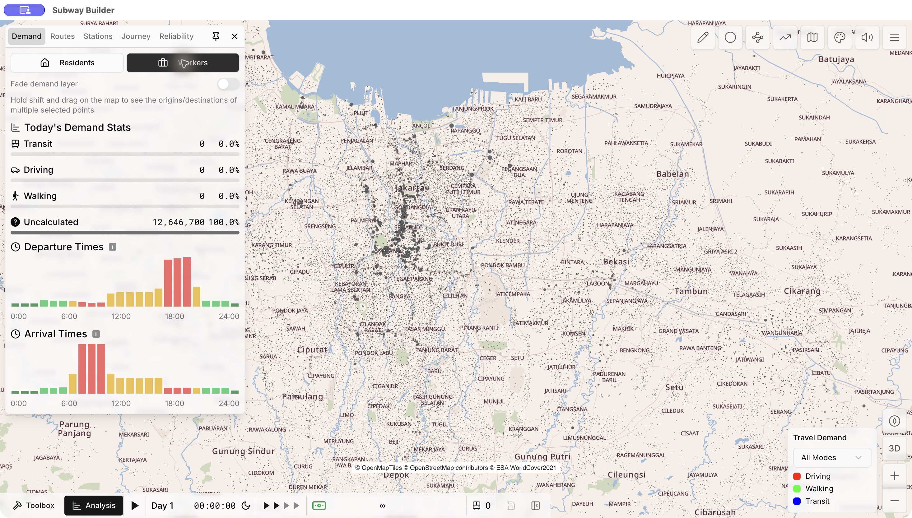

# Organic demand v4.1 — implementasi S0 + OD40

**Selesai dan terpasang lokal, termasuk uji game1.7.2 serta save/load.** Mod **0.2.2**, engine1.7.2 tidak diubah. Pengguna menyetujui kelanjutanS0+OD40 sesudah StageA. S1, OD30, peningkatan total demografi, dan pemindahan jobs antarregion tidak diterapkan.

## Perubahan final

| Metrik | v4 | v4.1 final |
|---|---|---|
| Seluruh inhabitants | 32,615,007 | 32,615,007 |
| Working trip-makers / jobs | 12,646,700 | 12,646,700 |
| Allocation anchors | 115929 | 115994 |
| Active engine points | 78404 | 78341 |
| Demand gzip bytes | 3895853 | 3894292 |
| OD lintas kab/kota | 5058600 | 5058600 |
| Distance decay | 18 | 18 |
| Kontrol penduduk tepat | 446 | 446 |

33cluster bermasalah dibuka dan **238konstituen** diperiksa.146anggota berupa tank/gasometer/parking dibuang dari kapasitas hunian/pekerjaan; bangunan layanan dengan atribut parkir dipertahankan sesuai fungsi utama. Total159konstituen mempunyai klasifikasi nonhunian positif/inferred, semuanya mempunyai **nol inhabitants dan asal pekerja** pada hasil akhir. Tetangga residential yang sah tetap terwakili pada interior bangunannya. Fungsi yang tidak diketahui tidak otomatis dikosongkan.

Enam hanggar nyata dipulihkan dengan prior transport v4 **150m²/relative-worker**, menghasilkan **2,200 model jobs** pada hanggar. Gedung kantor/layanan yang dikenali memakai koefisien fungsi v4 yang sudah ada dan level bangunan sebelumnya; tidak ada intensitasS1 atau perkiraan shift pekerja baru.33cluster ditangani pada level bangunan individual agar agregasi tidak melintasi fasilitas yang sedang dikoreksi. Anchor lain mempertahankan koordinat v4.

Perubahan antar-source-anchor (half-L1): **11,968 inhabitants**, **4,800 working origins**, **6,800 jobs**. Seluruh total desa/kelurahan inhabitants dan asal pekerja tetap; seluruh13total pekerjaan regional tetap. Pembulatan group100 dan perubahan fungsi menyebabkan redistribusi titik, bukan pertumbuhan penduduk.

**Angka StageA adalah preview, bukan hasil final ini.** Preview mengosongkan keseluruhan anchor; implementasi memeriksa seluruh anggota dan mempertahankan fungsi layanan serta rumah tetangganya. Karena itu relokasi inhabitants final berbeda dari12,142pada preview. [Per-member ledger](organic-v41-stage-b/member_reclassification.csv), [source-anchor changes](organic-v41-stage-b/changed_source_anchors.csv), [62area](organic-v41-stage-b/area_comparison.csv), [regional](organic-v41-stage-b/regional_comparison.csv).

## Bandara dan akses

| Aerodrome terpetakan | v4 | v4.1 |
|---|---|---|
| Inhabitants model | 7996 | 6325 |
| Asal pekerja model | 2800 | 1900 |
| Jobs model | 13500 | 16200 |

Titik hanggar dan fasilitas operasional bandara dipilih10m ke dalam bangunan pada sisi yang menghadap jalan lokal terpetakan di luar mask airside. Garis akses terpilih tidak memotong available runway/taxiway/apron atau water masks. Ini **inferensi akses**, bukan posisi pintu karyawan hasil survei. Jalan privat, gerbang keamanan, kapasitas shift dan staffing aktual belum terverifikasi. [Facility access ledger](organic-v41-stage-b/facility_access.csv).

Inhabitants yang masih berada dalam aerodrome adalah alokasi pada bangunan berfungsi tidak diketahui, **bukan klaim bahwa jumlah tersebut benar-benar tinggal di bandara**. S0 memperbaiki bukti positif; tidak membuat blanket exclusion atau memaksakan benchmark pekerja bandara40–50ribu yang berbeda cakupan/tahun. Industri, staffing lokal dan neighborhood fallback lain tetap mempunyai keterbatasan yang dijelaskan dalam [master audit](ORGANIC_V41_MASTER_AUDIT.md).

## Validasi dan reproducibility

- 446kontrol penduduk,1,502margin desa dan seluruh marginal OD point/regional tepat; tidak ada penduduk/demand hilang atau terduplikasi.
- Setiap anchor berada dalam bangunan/parcel dan administrasi yang dirujuk. Nol hit pada available water/coast/forest-wetland/runway/taxiway/apron/major-road8m masks. Tidak ada final grid atau jitter.
- Allocation dan serialized demand diregenerasi byte-identik pada seed20261107.13×13rounding memakai balanced min-cost integer transport; objective fractional remainder yang sama dengan LProunding sebelumnya (kuantisasi cost1e-9), dengan tie break deterministik. Origin/destination conservation diverifikasi dari pop records, bukan dipercayakan pada counter metadata.
- Package validator1.7.2 lulus. Asset server lokal juga diperiksa mengirim SHAyang sama dengan kandidat terpasang.
- Map tiles,30,000-building index, roads dan aeroways tidak dibangun ulang. KreditWorldCover yang terduplikasi diperbaiki menjadi satu entri.

Hash demand final: `745238dcdef5351b39eb32eca9ff69322985fa695c3a0fd8701d6124a4e500db`.

[Independent validation](organic-v41-stage-b/validation.json), [reproducibility](organic-v41-stage-b/reproducibility.json), [method](../assets/JKT/demand-method.json), [status](../BUILD_STATUS.json).

## OD dan kinerja

OD40 tetap:39.9994%lintas kab/kota, decay18km, cost-noise6km. IDrumah/kerja tetap commuter groups100orang. Model Residents tetap working origins, bukan semua inhabitants. S1dan additional non-work purposes tidak dimasukkan.

Cached allocation build9.10s; candidate generation6.63s; independent spatial/schema gate15.38s. Ini runtime tahap cached, bukan keseluruhan ekstraksi OSM. Jumlah active points berkurang63 dibanding v4, sementara underlying anchors bertambah65 karena split fungsi dan hanggar; penambahan itu untuk validitas fasilitas, bukan kerapatan visual.

Mapped-road sample:95/96reachable; detour median1.31,p901.82. Ini diagnostik tanpa turn/access restrictions atau congestion; drivingDistance/time seluruh demand tetap proxy1.35×jarak lurus,24km/jam+180s. Tidak diklaim semua trip telah dirutekan atau terkalibrasi terhadap2026traffic.

## Uji game

Save **Jabodetabek Organic v4.1 S0 OD40 QA** dibuat dan dimuat kembali. Residents/Workers, total12,646,700, titik2,300workers/23pops, pan/zoom diperiksa pada UI aktual. Save lama tidak ditimpa.

[Runtime record](organic-v41-stage-b/runtime_verification.json). Kinerja UI diperiksa kualitatif; bukan benchmark FPS atau simulasi jaringan metro besar. Snapshot RSS jika dicatat mencakup cache/mod lain dan tidak membuktikan peningkatan performa terisolasi.

## Rollback dan reproduksi

Backup produksi v4 sebelum instalasi disimpan dalam [rollback-v4](organic-v41-stage-b/rollback-v4/manifest.json), termasuk demand, metode, config, mod, CSVdan dokumentasi yang diubah. Untuk rollback, tutup game lalu jalankan `scripts/organic_v41/rollback_v4.py --restore` dari repo dengan Python yang sesuai; script memeriksa seluruh hash backup sebelum menyalin. Jangan menyalin snapshot hasil StageA sebagai release.

Rebuild staging dari workspace: `build_s0.py`, lalu `build_demand.py`, `verify_release.py`, `route_release.py`, `release_comparison.py` dalam`scripts/organic_v41/`. Caches dan sumber v4 tetap dibutuhkan, tercatat dalam [StageA reproduction manifest](organic-v41/reproduction_manifest.json). `install_s0.py` memerlukan independent gate dan reproducibility; instalasi mereset status UI menjadi pending sehingga pengujian harus diulang.

Runtime mod terpasang tidak memerlukan full4.5juta-building scratch inventory. Seluruh jobs rinci/fungsi inferred serta uncertainty sumber2021/2022/2025 tetap didokumentasikan.
