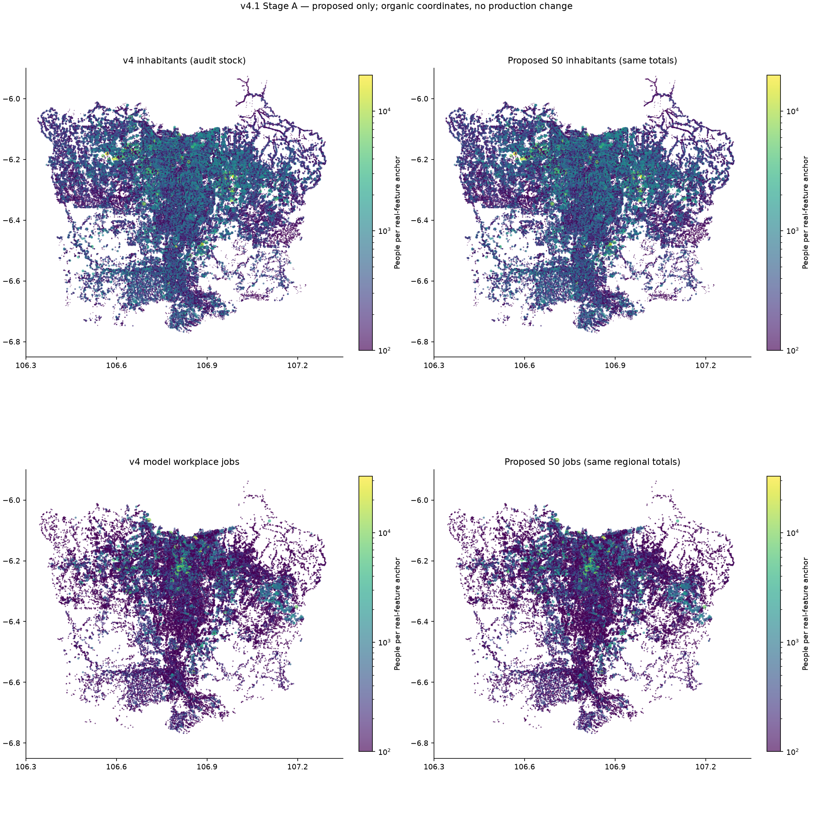

# Organic v4.1 — master audit

**Stage A — audit dan proposal, 8 November 2026. Belum diinstal dan belum diuji di game.** Produksi tetap Organic v4 / mod 0.2.1, commit `dfec7f2`. Tidak ada perubahan engine, peta, atau aset game.

Angka “penduduk” di dokumen ini adalah seluruh inhabitants; “asal pekerja” adalah model working trip-makers; “jobs” adalah estimasi tujuan kerja. S0 adalah koreksi klasifikasi konservatif. S1 adalah sensitivitas intensitas, **bukan** target pegawai hasil observasi. OD30 dan OD40 adalah skenario terpisah dari koreksi geografis S0.

Batas kecamatan/desa memakai union batas BIG Juni 2026. Kompleks industri memakai poligon OSM bernama; koridor bisnis memakai potongan poligon aktivitas dalam jendela audit. BSD/Gading Serpong/Alam Sutera/Sentul memiliki subset hunian terpetakan atau envelope administratif yang dilabeli: tidak diklaim sebagai batas legal township lengkap. Area tumpang tindih **tidak boleh dijumlahkan**. [Semua batas dan label cakupan](organic-v41/audit_boundaries.geojson.gz).

## Hasil yang dapat langsung ditinjau

| Metrik | Current v4 | S0 + OD30 review |
|---|---|---|
| Penduduk | 32,615,007 | 32,615,007 |
| Asal pekerja / jobs | 12,646,700 | 12,646,700 |
| Allocation anchors | 115,929 | 115,935 |
| Engine points aktif | 78,404 | 78,526 |
| Demand gzip bytes | 3,895,853 | 3,797,067 |
| Kontrol penduduk tepat | 446 | 446 |
| Pekerja lintas kab/kota | 5,058,600 | 3,793,900 |
| Median jarak lurus (km) | 5.78 | 4.02 |

S0 merelokasi **12,142 penduduk**, **4,800 asal pekerja**, dan **5,700 jobs** (masing-masing half-L1), dengan semua total desa/region tetap.33 anchor ditandai (28 berdasar tag positif,5 berdasar nama operasional bandara yang masih inferred);6 hanggar dipulihkan. Perbedaan4,700 pekerja yang berada pada anchor salah vs4,800 yang pindah total berasal dari pembulatan ulang100orang di desa terdampak.

Tidak ditemukan dasar untuk menaikkan semua pinggiran dengan multiplier. Alokasi administratif sudah tepat; masalah yang terukur terutama lokasi intra-desa, coverage dan fungsi gedung. S0 bukan penyelesaian seluruh kekurangan bukti pekerjaan. Pilot S1 hanya menunjukkan pengaruh prior fasilitas dan ceiling.

## Lima belas masalah paling konsekuensial

Urutan adalah penilaian dampak realistis/geografis oleh auditor, **bukan** ranking statistik hasil survei atau skor kepastian. Ukuran pada tiap baris dihitung dari data atau sumber yang disebut.

| Rank | Masalah | Ukuran/bukti | Kelas | Aksi |
|---|---|---|---|---|
| 1 | Partisipasi pekerja belum dikalibrasi penuh | Asal DKI4,191,700 vs Sakernas5.13juta; Kab Bogor2,129,800 vs2.62juta, dengan cakupan berbeda | Observed reference / inferred model | Audit cohort dan work-at-home; skenario demografi terpisah, bukan tambah20juta workers |
| 2 | Regional jobs historis / alamat kantor | 13 total tujuan masih kontrol historis JUTPI dan Jamsostek untuk kota Jakarta | Observed provenance / inferred physical jobs | Jangan pindahkan jobs lintasregion tanpa bukti physical-workplace independen |
| 3 | Fallback pekerjaan mendominasi wilayah satelit | Kab Bogor83.34%; Kota Bekasi73.46%; Kota Tangerang73.51% jobs melalui prior hunian | Inferred | Perluas inventaris/fungsi dan facility controls sebelum mengurangi fallback |
| 4 | Kawasan industri luas, fungsi gedung jarang eksplisit | GIIC explicit-tag 0.1%; Jababeka 1.5% | Observed tags / inferred function | Jangan konversi semua atap industri jadi pabrik dengan densitas identik |
| 5 | OD40 belum fit pada survei pekerja | 5,058,600 model cross-boundary; BPS2023 pekerja-komuter3,614,673, beda tahun/definisi | Gameplay calibration / observed survey | Bandingkan30/35/40%; harmonisasi sebelum fit final |
| 6 | Tidak ada perjalanan khusus non-kerja pada v4 | 0 UNI_/AIR_/BRD_ points; BPS800,301 komuter sekolah/kuliah/kursus lintaswilayah | Observed engine/data | Tambahkan ledger tujuan non-kerja dengan data pendidikan/pengunjung tersendiri |
| 7 | Penduduk di fungsi yang jelas nonhunian | 33 anchors; 12,142 inhabitants dan 4,700 asal pekerja pada anchor terindikasi | Observed tags / inferred operational names | S0 pindahkan dalam desa yang sama; audit ulang anggota cluster sebelum implementasi penuh |
| 8 | Hanggar bandara terhapus dari kesempatan kerja | 6 footprint hanggar,0 current jobs pada anchor hanggar; S0 menambah2,200 dihanggar | Observed geometry / inferred capacity | Pulihkan interior hanggar; cek pintu pekerja/access di StageB |
| 9 | Ekosistem CGK belum tercakup pasti | 13,500 current,15,000 S0,21,300 S1 dalam aerodrome; benchmark2022 tidak sebanding | Inferred / historical statement | Audit payroll/contractor per fasilitas; jangan force50,000 |
| 10 | Lantai dan fungsi tempat kerja masih inferensi | CGK level tercatat 3.2%; CBD tag fungsi tidak mengukur pegawai | Observed completeness / inferred heights | Gunakan building parts, operator facility evidence; jangan pakai footprint saja |
| 11 | Prior mixed-use besar bisa meresidentialkan fasilitas | Atap generic>=800m² diasumsikan60%residential/40%activity pada v4 | Inferred | Identifikasi fasilitas nonhunian dulu; S0 memperbaiki bukti positif, bukan blanket airport exclusion |
| 12 | Ceiling2 dan residual dapat mengencerkan pusat kerja | Sensitivitas ceiling1/2/3 dihitung dengan semua marginal regional tepat | Gameplay calibration | Tahan threshold produksi; S1 hanya uji diagnosis, bukan pengganti data |
| 13 | Coverage perumahan terputus dan referensi tua | Tenjolaya fallback-share 99.7%; WorldCover2021, Bogor population2022 | Observed provenance / inferred spatial stock | Update geometri terbangun dan skenario pertumbuhan dengan sumber; jangan boost visual |
| 14 | Waktu berkendara belum routing terukur | 1.35×jarak lurus,24km/jam+180s; sample v4 saja, tanpa kemacetan/turn restrictions | Gameplay calibration | Kalibrasi detour/speed dan jaringan pada StageB; tidak klaim waktu aktual |
| 15 | Agregasi/display dapat disangka kekurangan penduduk | 78,404 active engine points vs115,929 anchors; game building index30,000; group100 | Observed format / display limitation | Bedakan inhabitants, origins dan visual index; COVERAGE.md lama masih menyebut grid500m v3 |

## Hasil validasi

446 kontrol diperiksa ulang secara independen. Populasi32,615,007; origins/jobs12,646,700; seluruh point/pop references dan OD marginal tepat. Seluruh anchor berada di building/parcel yang dirujuk dan administrasinya. Nol hit pada **mask terpetakan yang tersedia**: water/coast, forest/wetland, runway/taxiway/apron, major-road8m proxy. Ini tidak membuktikan seluruh akses airside diketahui: pintu karyawan dan jalan privat perlu pemeriksaan fasilitas sebelum game release.

Koordinat v4 tidak digeser;6 titik tambahan adalah interior hanggar nyata. Tidak ada grid/jitter/penyebaran uniform. Raster internal hanya mengukur coverage historis, tidak menjadi titik final. [Validasi kandidat](organic-v41/validation.json), [pemeriksaan selesai](organic-v41/completion_checks.json), [seluruh detail area](organic-v41/AREA_DETAILS.md).

## Dokumen dan data

- [Audit perumahan](SUBURBAN_RESIDENTIAL_AUDIT.md).
- [Audit pekerjaan](EMPLOYMENT_DENSITY_AUDIT.md).
- [Audit bandara dan industri](AIRPORT_INDUSTRIAL_EMPLOYMENT_AUDIT.md).
- [Audit populasi–demand](POPULATION_DEMAND_GAP_AUDIT.md).
- [Proposal yang perlu persetujuan](ORGANIC_V41_CALIBRATION_PROPOSAL.md).
- [Point current/proposed](organic-v41/point_comparison.csv.gz), [kelurahan](organic-v41/village_comparison.csv), [regional](organic-v41/regional_comparison.csv), [area](organic-v41/area_comparison.csv), [skenario OD](organic-v41/od_sensitivity.json).

## Provenance dan tingkat kepastian

**Observed:** angka kontrol/survei, tag/footprint terpetakan, dan pernyataan operator; tidak otomatis berarti staffing aktual. **Inferred:** fungsi dari konteks/nama, lantai berguna, lokasi penduduk/pekerjaan. **Gameplay calibration:** rasio kapasitas, ceiling, parameter dan pasangan OD. Semua jobs rinci tetap estimasi.

| ID | Sumber / periode | Cakupan dan penggunaan |
|---|---|---|
| BPS_COMMUTER_2023 | [BPS Indonesia](https://www.bps.go.id/en/publication/2024/03/28/33b6bef825944e576e7ea3ba/commuter-statistics-of-jabodetabek-results-of-jabodetabek-commuter-surveys-2023.html) / 2023 | Age5+ regular same-day cross-kabupaten/kota commuters, Table4/5; not all employed residents, not daily passenger boardings. Includes five Jakarta cities separately. Sampling and reference-year mismatch remain. |
| BPS_DKI_LABOUR_2025 | [BPS DKI Jakarta](https://jakarta.bps.go.id/id/pressrelease/2025/11/05/1243/keadaan-ketenagakerjaan-provinsi-dki-jakarta-agustus-2025.html) / 2025 | Sakernas August2025 by residence, Jakarta province including Seribu; cannot become physical-workplace destinations |
| BPS_BOGOR_LABOUR_2025 | [BPS Kabupaten Bogor](https://bogorkab.bps.go.id/id/pressrelease/2025/12/22/386/labor-force-conditions-in-bogor-regency--august-2025.html) / 2025 | Resident employment, not jobs inside regency; baseline resident population reference2022 differs |
| BPS_BOGOR_CITY_LABOUR_2025 | [BPS Kota Bogor](https://bogorkota.bps.go.id/id/statistics-table/2/MTE0OSMy/jumlah-penduduk-usia-kerja-angkatan-kerja-bekerja-pengangguran-terbuka-dan-tingkat-partisipasi-angkatan-kerja-dan-tingkat-pengangguran-terbuka-di-kota-bogor.html) / 2025 | Units thousand persons checked from table context; indicative only; no calibration target |
| CGK_APII_2022 | [AP II President Director statement carried by ANTARA](https://mandalika.antaranews.com/berita/3294487/ap-ii-proyeksi-bandara-soekarno-hatta-layani-80-juta-penumpang-di-2030) / 2022 | Broad airport worker community per day, unclear unique headcount/contractors/shifts/offsite coverage. NOT verified40000–50000 current payroll target. Future Terminal4/Cargo Village proposals in article are NOT built into scenario. |
| JABABEKA_PROFILE | [PT Jababeka](https://www.jababeka.com/id/tentang-kami/) / tidak bertanggal | Undated township profile including other functions; not a2025 measured sum of jobs in OSM industrial polygons |
| JABABEKA_2026_MARKETING | [PT Jababeka](https://www.jababeka.com/jababeka-handover-of-units-jababeka-bizpark-phase-i/) / 2026 | Captive market includes township and surrounding economy; not a staffing target; not added to older700000 disclosure |
| MM2100_2025 | [Marubeni operator/investor](https://marubeni-industrialpark.com/articles/20251110_01j) / 2025 | Article10November2025; partner areas included, not occupied factory land;200 companies attending anniversary is NOT a complete tenant or worker census |
| EJIP_PROFILE | [PT East Jakarta Industrial Park](https://www.ejip.co.id/id/outline) / tidak bertanggal | No verified employee total on profile; tenant counts not converted to invented per-company staffing |
| GIIC_PROFILE | [PT Puradelta Lestari](https://deltamas.id/en/) / tidak bertanggal | Tenant count not staffing. Data centers are not labour-intensive generic factories; no announced expansion treated as built floor area |
| DEPOT | [Subway-Builder-Modded](https://github.com/Subway-Builder-Modded/depot) / tidak bertanggal | DemandData special-demand generator and type definitions; checked against installed1.7.2 bundles, not assumed feature parity |

Sumber pemda yang sudah dipakai tetap tersedia dalam [manifest pemerintah](../sources/government/source_manifest.json), [kontrol penduduk](../sources/government/population_controls.json), dan [quality issues](../sources/government/quality_issues.json). Detail akses, fakta terpilih dan keterbatasan: [source_evidence.json](organic-v41/source_evidence.json). Tidak ada pengumuman fasilitas masa depan yang dianggap sudah terbangun.
