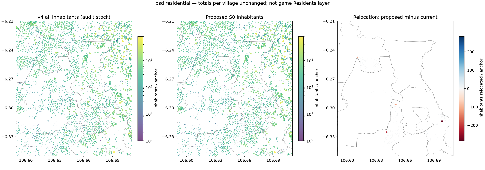
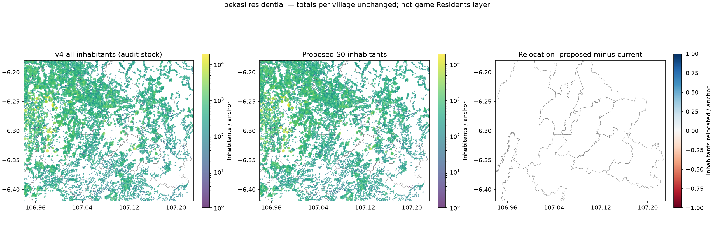
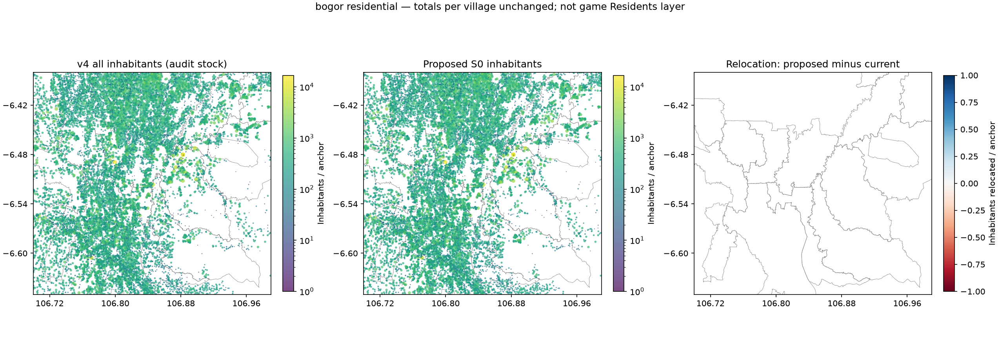

# Audit perumahan suburban

**Stage A — audit dan proposal, 8 November 2026. Belum diinstal dan belum diuji di game.** Produksi tetap Organic v4 / mod 0.2.1, commit `dfec7f2`. Tidak ada perubahan engine, peta, atau aset game.

Angka “penduduk” di dokumen ini adalah seluruh inhabitants; “asal pekerja” adalah model working trip-makers; “jobs” adalah estimasi tujuan kerja. S0 adalah koreksi klasifikasi konservatif. S1 adalah sensitivitas intensitas, **bukan** target pegawai hasil observasi. OD30 dan OD40 adalah skenario terpisah dari koreksi geografis S0.

Batas kecamatan/desa memakai union batas BIG Juni 2026. Kompleks industri memakai poligon OSM bernama; koridor bisnis memakai potongan poligon aktivitas dalam jendela audit. BSD/Gading Serpong/Alam Sutera/Sentul memiliki subset hunian terpetakan atau envelope administratif yang dilabeli: tidak diklaim sebagai batas legal township lengkap. Area tumpang tindih **tidak boleh dijumlahkan**. [Semua batas dan label cakupan](organic-v41/audit_boundaries.geojson.gz).

## Batas dan pembanding yang sah

Setiap kecamatan/desa prioritas mempunyai geometri BIG dan total terkontrol; BSD/Gading Serpong/Alam Sutera/Sentul memakai subset/envelope yang dinyatakan. Total township pemasaran tidak dibandingkan langsung dengan potongan poligon. “Nambo” di sini adalah desa Nambo di Klapanunggal, bukan sekadar radius stasiun; Sentul dibandingkan pula dengan Babakan Madang dan Sukaraja. Kota Bekasi dan Kota Bogor diaudit sebagai kota serta kecamatan sekitar.

Seluruh **183 kecamatan** dan1,502desa/kelurahan dibandingkan.317 kontrol kelurahan langsung,129 kontrol kecamatan:1,185 angka desa sisanya adalah pembagian perkiraan yang tetap dipertahankan. Semua total desa dan kecamatan current/S0 identik; perbedaan potongan area semata hasil relokasi intra-desa, bukan menambah penduduk.

| Area / cakupan | Penduduk current→S0 | Asal pekerja current→S0 | Jobs current→S0 | Fallback inhabitants | Bukti |
|---|---|---|---|---|---|
| Serpong · Kota Tangerang Selatan | 174,979 → 174,979 | 60,500 → 60,500 | 100,500 → 100,500 | 0 | BIG June2026 village union |
| Serpong Utara · Kota Tangerang Selatan | 146,305 → 146,305 | 58,000 → 58,000 | 79,700 → 79,700 | 31,683 | BIG June2026 village union |
| Cisauk · Tangerang | 101,292 → 101,292 | 38,900 → 38,900 | 45,700 → 45,500 | 0 | BIG June2026 village union |
| Pagedangan · Tangerang | 124,010 → 124,010 | 46,900 → 46,900 | 109,700 → 109,700 | 0 | BIG June2026 village union |
| Kelapa Dua · Tangerang | 176,856 → 176,856 | 69,700 → 69,700 | 122,300 → 122,200 | 0 | BIG June2026 village union |
| Cikupa · Tangerang | 217,637 → 217,637 | 86,500 → 86,500 | 87,700 → 87,700 | 0 | BIG June2026 village union |
| Balaraja · Tangerang | 132,628 → 132,628 | 51,300 → 51,300 | 51,700 → 51,800 | 0 | BIG June2026 village union |
| Tambun Selatan · Bekasi | 454,767 → 454,767 | 178,500 → 178,500 | 106,200 → 106,200 | 0 | BIG June2026 village union |
| Tambun Utara · Bekasi | 215,396 → 215,396 | 81,900 → 81,900 | 54,600 → 54,600 | 0 | BIG June2026 village union |
| Cibitung · Bekasi | 288,993 → 288,993 | 107,300 → 107,300 | 63,000 → 63,000 | 0 | BIG June2026 village union |
| Cikarang Barat · Bekasi | 223,090 → 223,090 | 87,300 → 87,300 | 161,100 → 161,100 | 0 | BIG June2026 village union |
| Cikarang Utara · Bekasi | 252,335 → 252,335 | 102,600 → 102,600 | 168,500 → 168,500 | 0 | BIG June2026 village union |
| Cikarang Selatan · Bekasi | 186,614 → 186,614 | 65,200 → 65,200 | 146,700 → 146,700 | 0 | BIG June2026 village union |
| Cikarang Pusat · Bekasi | 72,276 → 72,276 | 27,300 → 27,300 | 98,000 → 98,000 | 0 | BIG June2026 village union |
| Klapanunggal · Bogor | 108,056 → 108,056 | 44,700 → 44,700 | 37,400 → 37,400 | 17,879 | BIG June2026 village union |
| Gunung Putri · Bogor | 291,673 → 291,673 | 111,500 → 111,500 | 128,000 → 128,000 | 45,158 | BIG June2026 village union |
| Citeureup · Bogor | 219,520 → 219,520 | 86,600 → 86,600 | 96,700 → 96,700 | 137,472 | BIG June2026 village union |
| Cileungsi · Bogor | 269,651 → 269,651 | 102,900 → 102,900 | 83,500 → 83,500 | 0 | BIG June2026 village union |
| Cibinong · Bogor | 361,127 → 361,127 | 142,200 → 142,200 | 123,300 → 123,300 | 0 | BIG June2026 village union |
| Bojonggede · Bogor | 262,003 → 262,003 | 107,900 → 107,900 | 83,200 → 83,200 | 68,034 | BIG June2026 village union |
| Tajurhalang · Bogor | 122,489 → 122,489 | 47,000 → 47,000 | 47,300 → 47,300 | 43,909 | BIG June2026 village union |
| Parung · Bogor | 126,689 → 126,689 | 44,900 → 44,900 | 71,100 → 71,100 | 105,419 | BIG June2026 village union |
| Kemang · Bogor | 125,641 → 125,641 | 52,800 → 52,800 | 42,300 → 42,300 | 57,668 | BIG June2026 village union |
| Dramaga · Bogor | 112,265 → 112,265 | 42,400 → 42,400 | 43,000 → 43,000 | 56,670 | BIG June2026 village union |
| Babakan Madang · Bogor | 119,231 → 119,231 | 48,100 → 48,100 | 85,100 → 85,100 | 55,814 | BIG June2026 village union |
| Sukaraja · Bogor | 199,452 → 199,452 | 79,000 → 79,000 | 47,200 → 47,200 | 10,709 | BIG June2026 village union |
| Kota Bekasi | 2,595,927 → 2,595,927 | 1,010,100 → 1,010,100 | 840,200 → 840,200 | 729,708 | BIG June2026 village union |
| Kota Bogor | 1,156,543 → 1,156,543 | 450,000 → 450,000 | 437,400 → 437,400 | 0 | BIG June2026 village union |
| Rawa Buntu | 30,657 → 30,657 | 11,800 → 11,800 | 12,600 → 12,600 | 0 | BIG village boundary |
| Nambo | 10,300 → 10,300 | 3,900 → 3,900 | 6,000 → 6,000 | 0 | BIG village boundary |
| BSD City mapped housing parcels | 174,813 → 174,764 | 64,500 → 64,400 | 190,000 → 189,900 | 0 | Named OSM residential parcels |
| Gading Serpong mapped housing parcels | 86,989 → 87,094 | 36,500 → 36,600 | 83,300 → 83,300 | 0 | Named OSM residential parcels |
| Alam Sutera mapped housing parcels | 62,209 → 62,209 | 25,600 → 25,600 | 75,400 → 75,400 | 0 | Named OSM residential parcels |
| Sentul mapped housing parcels | 46,673 → 46,673 | 19,300 → 19,300 | 31,200 → 31,200 | 6,706 | Named OSM residential parcels |

## Morfologi dan coverage

Kampung padat memakai banyak atap kecil; estate modern bisa mempunyai atap lebih besar dan ruang terbuka lebih luas. Apartemen perlu floor area, tidak hanya luas tapak. Jumlah titik yang tampak jarang dapat berasal dari agregasi200/350/500m atau pembulatan100 working trip-makers; **bukan bukti inhabitants hilang**. Rincian jumlah bangunan, apartment-tag, roof area, coverage fungsi/level serta rasio population/capacity tersedia untuk setiap area dalam [tabel detail](organic-v41/AREA_DETAILS.md) dan [CSV](organic-v41/area_comparison.csv).

S0 meninjau33 anchor:28 bertag nonhunian positif,5 fungsi operasional bandara diinferensi dari nama dan konteks. Kelima kasus inferred perlu pemeriksaan fasilitas sebelum implementasi.12,142 inhabitants dipindah hanya ke anchor residential yang sudah ada dalam desa yang sama. Unknown airport buildings tidak otomatis dikosongkan;5,104 inhabitants masih berada dalam batas aerodrome, dengan fungsi rumah yang belum terverifikasi. Itu **risiko residual**, bukan klaim ada5,104 penghuni bandara sebenarnya. Sebelum StageB penuh, anggota cluster di sekitar bangunan yang dikoreksi perlu diklasifikasi kembali; preview ini mempertahankan geometri/cluster lama agar dampak mudah diukur.

## Cluster tambahan untuk pemeriksaan coverage

Peringkat ini memilih ketergantungan fallback tinggi, bukan menyatakan underpopulation. Jumlah penduduknya tetap sesuai kontrol; yang lemah adalah bukti sebaran internal. Sumber fallback WorldCover2021 lebih tua dari kondisi2025–2026.

| Wilayah / kecamatan | Penduduk current=S0 | Asal pekerja | Penduduk pada fallback | Population / relative-capacity |
|---|---|---|---|---|
| Bogor / Tenjolaya | 67,678 | 25,300 | 99.7% | 0.68 |
| Bogor / Cibungbulang | 150,792 | 56,600 | 99.4% | 0.67 |
| Bogor / Leuwisadeng | 81,557 | 29,700 | 99.4% | 0.80 |
| Bogor / Cigombong | 100,390 | 39,200 | 97.6% | 0.59 |
| Bogor / Rancabungur | 62,714 | 25,200 | 97.0% | 0.63 |
| Kota Tangerang / Ciledug | 157,632 | 58,400 | 95.6% | 0.68 |
| Kota Tangerang / Karang Tengah | 123,568 | 44,700 | 95.1% | 0.48 |
| Bogor / Ciseeng | 118,758 | 47,600 | 92.0% | 0.59 |
| Bogor / Pamijahan | 163,186 | 62,600 | 91.9% | 0.76 |
| Bogor / Ciampea | 173,460 | 68,700 | 91.6% | 0.69 |
| Bogor / Leuwiliang | 131,352 | 51,800 | 89.7% | 0.78 |
| Kota Tangerang / Batuceper | 98,070 | 39,700 | 84.0% | 0.68 |
| Bogor / Sukajaya | 70,078 | 29,900 | 83.2% | 0.90 |
| Bogor / Jasinga | 111,350 | 43,600 | 80.5% | 0.96 |
| Bogor / Tanjungsari | 60,499 | 25,400 | 79.9% | 0.68 |

Gambar ini membandingkan **seluruh inhabitants** pada anchor aktual, dengan panel selisih relokasi. Itu bukan layer Residents di game. Stok inhabitants dan jobs pada [peta metro](organic-v41/metro_before_after.png). Tidak ada alasan kuantitatif dalam audit ini untuk menerapkan multiplier suburban menyeluruh. Untuk Bogor, pertumbuhan2022→2025 perlu skenario terpisah dengan sumber terbaru, bukan diekstrapolasi diam-diam.

Data: [seluruh kecamatan](organic-v41/all_district_comparison.csv), [desa](organic-v41/village_comparison.csv), [koreksi anchor](organic-v41/residential_anchor_corrections.csv), [batas](organic-v41/audit_boundaries.geojson.gz). Provenance dan batas definisi: [master audit](ORGANIC_V41_MASTER_AUDIT.md#provenance-dan-tingkat-kepastian).
